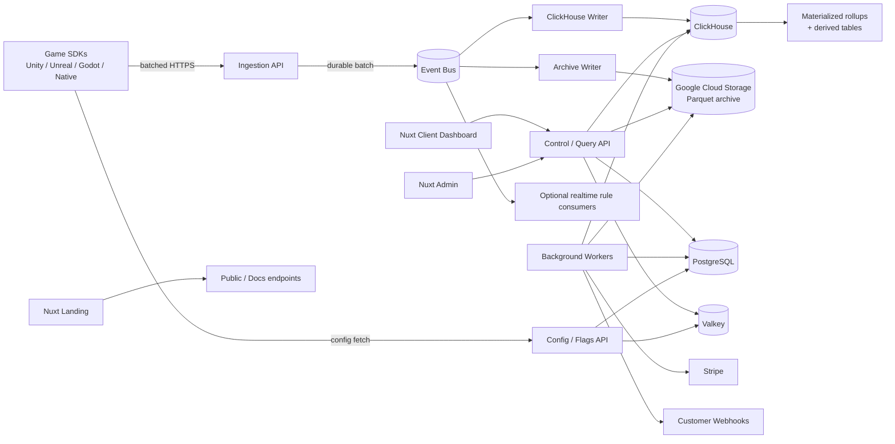

# PlayerSense — Project Architecture & Product Blueprint

> **Document:** `project.md`  
> **Product:** PlayerSense  
> **Status:** Architecture blueprint / implementation source of truth  
> **Primary backend:** Go using the Muzak framework (`muzak.dev`)  
> **Frontend:** Nuxt — three independent applications: Landing, Client, Admin  
> **Primary cloud:** Google Cloud Platform  
> **Initial production strategy:** low-cost self-managed stateful infrastructure on VPS + managed GCP primitives where they materially reduce operational risk  
> **Scale target:** from zero traffic to **1 billion accepted analytics events per day** without redesigning the product model or API contracts

---

## 1. What PlayerSense is

PlayerSense is a game-development platform whose center of gravity is **game analytics**, but it is intentionally broader than a traditional analytics dashboard.

The platform should become a shared operating layer for a game studio. A studio integrates one PlayerSense SDK and receives a connected set of services:

- realtime and historical game analytics;
- sessions, DAU/WAU/MAU, retention, funnels, cohorts and revenue analysis;
- custom events and custom event properties;
- player timelines and debugging;
- feature flags and remote configuration;
- LiveOps campaigns and scheduled configuration changes;
- experiments and percentage rollouts;
- purchase verification and normalized purchase events;
- outbound webhooks;
- data export;
- data retention controls;
- usage and storage metering;
- organization/project/team management;
- API access for studios that want to build their own internal tools.

PlayerSense is **not** intended to be only a charting UI over a database. The long-term product goal is to become infrastructure that is safe to leave permanently inside a production game.

---

## 2. Product goal

The product goal is:

> Give game developers one lightweight SDK and one control plane for understanding, configuring, operating and monetizing their games without requiring them to build their own analytics pipeline, feature-flag service, LiveOps backend, purchase-verification layer and webhook system.

The architecture must satisfy two apparently conflicting constraints:

1. **Prefund economics:** the product must be cheap enough to launch before meaningful revenue exists.
2. **Large-scale architecture:** the software model must not be thrown away if one or more customers become very large.

The answer is not to make Stage 1 hardware magically handle Stage 2 traffic. A single 500 GB VPS cannot physically retain one billion events per day indefinitely. The correct target is:

> **The same contracts, data model and service boundaries must scale from Stage 1 to Stage 2; capacity is added by replacing or scaling infrastructure, not by rewriting the product.**

---

## 3. Core architecture principles

### 3.1 Separate the control plane from the data plane

PlayerSense has two fundamentally different workloads.

**Control plane** data is relational, transactional and relatively small:

- users;
- organizations;
- memberships;
- projects;
- environments;
- API keys;
- feature-flag definitions;
- LiveOps definitions;
- retention policies;
- billing configuration;
- webhook endpoints;
- verified purchases;
- audit records;
- entitlements.

This belongs in **PostgreSQL**.

**Data plane** traffic is high-volume, append-heavy and analytical:

- game events;
- session activity;
- feature exposures;
- revenue analytics;
- derived metrics;
- cohort facts;
- retained event archives.

This belongs in **ClickHouse + GCS**, not PostgreSQL.

---

### 3.2 The ingestion API must never synchronously run dashboard analytics

The ingestion path has one job: accept a valid batch, durably enqueue it and return quickly.

It must not:

- execute dashboards;
- calculate retention;
- run funnels;
- execute large PostgreSQL transactions;
- call customer webhooks synchronously;
- wait for long analytical queries;
- insert events one by one.

This isolates ingestion reliability from query load.

---

### 3.3 Batches are the unit of transport

PlayerSense SDKs must buffer locally and send **event batches**, not one HTTP request per event.

A sensible initial SDK policy is:

- flush every 2–5 seconds while active;
- or flush when roughly 100–500 events have accumulated;
- or flush when the compressed body reaches a configurable size limit;
- flush on application background/pause when possible;
- persist unsent batches locally when the network is unavailable;
- retry with exponential backoff and jitter;
- assign a stable `batch_id` so retries are idempotent.

Exact thresholds are SDK-tunable and may differ by engine/platform.

---

### 3.4 Object storage is the retention layer; local SSD is the hot layer

A VPS with a 500 GB disk must be treated as bounded storage.

Do not design PlayerSense around continuously increasing one local filesystem. Instead:

- recent/hot raw events live in ClickHouse on NVMe/SSD;
- long-lived canonical raw archives live in Google Cloud Storage;
- aggregates remain in ClickHouse because they are much smaller than raw telemetry;
- old raw data can be queried asynchronously from GCS or temporarily hydrated when required;
- Stage 2 managed ClickHouse can keep much more raw data directly in object-backed storage.

This is the same broad architectural idea used by modern cloud data systems: durable storage is separated from compute and local disks become caches/hot working sets rather than the only copy of the data.

---

### 3.5 Optimize the common query path, not every theoretical query

Most analytics page loads should never scan the raw event table.

PlayerSense should answer common product queries from pre-aggregated tables:

- event totals;
- DAU/WAU/MAU;
- session counts;
- average session length;
- revenue;
- payer count;
- ARPDAU/ARPU;
- platform/country/version breakdowns;
- retention curves, classic and rolling;
- install cohorts and the sticky acquisition dimensions that slice them;
- playtime along the cohort curve, and lifetime-playtime segments;
- cumulative revenue per cohort day, payer conversion and spend segments;
- progression and experiment-variant cohorts;
- active-player trends.

Cohorts are the case where this principle is easiest to violate. A cohort crosses *when a
player arrived* with *what they did afterwards*, and the obvious implementation joins the
raw event table to a player dimension on a player-cardinality key. At the scale this
document targets that is a hash build over hundreds of millions of keys, running on the
same node that is absorbing ingestion.

PlayerSense therefore stamps the cohort key onto the row **before it is written**, so every
cohort query reads one pre-crossed table and joins nothing. See §29.

Raw data is reserved for:

- player timelines;
- ad hoc exploration;
- saved funnels that cannot be answered from an existing summary;
- debugging;
- exports;
- reprocessing.

---

### 3.6 Keep infrastructure replaceable behind internal interfaces

The application code should not be tightly coupled to a single deployment product.

Examples:

```go
// Conceptual interfaces, not framework-specific code.
type EventBus interface {
    PublishBatch(ctx context.Context, batch *EventBatch) error
}

type AnalyticsStore interface {
    InsertBatch(ctx context.Context, batch *NormalizedBatch) error
    Query(ctx context.Context, q AnalyticsQuery) (AnalyticsResult, error)
}

type Cache interface {
    Get(ctx context.Context, key string) ([]byte, error)
    Set(ctx context.Context, key string, value []byte, ttl time.Duration) error
}
```

This allows:

- Stage 1 PostgreSQL -> Stage 2 Cloud SQL/AlloyDB;
- Stage 1 Valkey -> Stage 2 Memorystore for Valkey;
- Stage 1 self-hosted ClickHouse -> Stage 2 ClickHouse Cloud;
- an emergency Pub/Sub alternative without changing the SDK protocol.

---

## 4. Scale envelope

The system should be designed around these envelopes.

| Level | Accepted events/day | Average events/sec | Operational meaning |
|---|---:|---:|---|
| Dev | 0–100k | <2 | Local/dev/test titles |
| Early production | 1M | ~12 | Indie/small games |
| Growing | 10M | ~116 | Successful title or several customers |
| Large | 100M | ~1,157 | Serious studio traffic |
| Target ceiling | 1B | ~11,574 | Platform-scale ingestion |

The average is not enough for sizing. Games have launch spikes, daily resets, campaign events and regional peaks. The data plane should be tested for at least **5–10× the average event rate** for short periods.

### 4.1 Why batching changes the HTTP problem

One billion events/day sounds like an enormous request rate if every event is sent individually. It is much smaller if the SDK sends batches.

For example:

- 100 events/request -> 10 million ingestion requests/day -> ~116 requests/sec average;
- 500 events/request -> 2 million requests/day -> ~23 requests/sec average.

The hard part is therefore not HTTP request count. The hard parts are:

- bytes ingested;
- durable buffering;
- ClickHouse merge pressure;
- high-cardinality analytics;
- query concurrency;
- long-term storage;
- data retention and deletion.

### 4.2 Why 500 GB is not a billion-event retention solution

If the normalized event size averaged only 500 bytes:

- 1B events/day ~= 500 GB/day before database compression and indexes.

At 1 KB/event:

- 1B events/day ~= 1 TB/day before compression.

ClickHouse compression can be excellent, but compression must be treated as a benefit, not a capacity guarantee. Therefore the architecture must keep local raw retention bounded and move durable long-term retention to object storage.

---

## 5. High-level architecture



---

## 6. Region and cell

PlayerSense is a **cell-based data plane** from the start, even though only one cell exists
for years.

### The two words mean different things

They are separated because they split for different reasons, and conflating them is how a
system ends up unable to answer "where is our players' data".

**A region is a legal boundary** — `eu`, `us`. It says what law applies and where bytes may
sit. Regions exist because a customer's procurement asks the question and because a
regulator can, in principle, ask it too.

**A cell is one stack inside a region** — `eu-1`, `eu-2`. It is a unit of capacity and of
blast radius. One region may hold several cells, and splitting one is an engineering
decision that needs nobody's legal opinion.

### What a cell contains

One complete, self-contained copy of the machinery that stores and processes events:

- an ingestion endpoint;
- a queue/topic;
- ClickHouse capacity;
- a PostgreSQL database for everything that names a player (§99);
- archive writers and a regional GCS prefix/bucket;
- query workers;
- Valkey, for the cache, the rate-limit counters and the device state.

A project is assigned to exactly one cell **at creation** and its data never leaves it. The
assignment is immutable for the reason §75 gives about `policy_tier`: a project that could
change cells is a project whose stored rows no longer all mean the same thing.

```text
project A -> eu-1
project B -> eu-1
project C -> us-1
project D -> asia-1
```

### The registry

The global control plane (§11) holds a `cells` table: slug, region, status, and the public
ingest URL. It holds identity and endpoints and deliberately **never credentials** — a
table of database passwords is a table of database passwords. DSNs live in each service's
own environment, and a service asserts at start-up that the cell it was configured as
exists and agrees with its configuration, so a typo fails to boot rather than writing
somewhere nobody is reading.

`status` is `active`, `draining` or `readonly`. A draining cell still serves the projects
it holds but accepts no new ones; a readonly cell serves queries only, which is what
migrating out of a cell needs.

### A foreign key at a gateway is refused, not served

A gateway that receives a key belonging to another cell answers **421 Misdirected Request**
and names the `ingest_url` that can serve it.

This is the single most important rule in the whole cell design. Without it, one wrong
hostname in an SDK configuration puts one region's player data on another region's disks —
the exact outcome the design exists to prevent, defeated by a typo. 421 rather than 403
because the request is well-formed and the credential is good; it simply arrived somewhere
that cannot serve it, and a misconfigured integration is better told where to go than
merely refused.

### What it buys

- data residency is real rather than aspirational;
- EU and US event traffic does not cross the world;
- one very large customer can be moved to a dedicated cell;
- analytics failures are isolated to a cell;
- the system grows past one ClickHouse cluster without inventing cross-region sharding.

### One thing a cell is not

The control plane is **not** a cell. There is exactly one of it, it is global, and it holds
no player data at all (§99). That is what lets it stay singular — and it has a second,
purely mechanical consequence worth stating: every entity's auto-increment id becomes an
`org_seq` / `project_seq` / `environment_seq` in ClickHouse's sort keys. One global tier
means one allocator, so those integers are globally unique and two cells' rows can never
blend. Replicating the control plane per region would have required inventing a surrogate
allocation scheme first.

**Stage 1:** one cell.  
**Stage 2:** add cells only when justified.

---

# Part I — Deployment stages

## 7. Stage 1 — prefund production

Stage 1 optimizes for low fixed monthly cost while preserving the final architecture.

### 7.1 Recommended deployment

At the absolute beginning, one good NVMe VPS can run:

- Go control API;
- Go ingestion API;
- Go query API;
- Go workers;
- PostgreSQL;
- Valkey;
- ClickHouse;
- reverse proxy / TLS termination.

However, this is an **economics choice**, not the scale architecture.

The first component that should be moved to its own machine is **ClickHouse** because it competes aggressively for CPU, RAM and disk I/O.

A practical Stage 1 evolution is:

### Stage 1A — first production customers

```text
VPS-1
  - control-api
  - ingest-api
  - query-api
  - workers
  - PostgreSQL
  - Valkey
  - ClickHouse

GCP
  - Pub/Sub
  - GCS
  - Secret Manager optionally
  - DNS / monitoring integrations as desired
```

### Stage 1B — growing traffic

```text
VPS-Control
  - control-api
  - query-api
  - workers
  - PostgreSQL
  - Valkey

VPS-Analytics
  - ClickHouse
  - clickhouse-writer
  - archive-writer scratch/cache

VPS-Ingest or autoscaled app nodes
  - ingest-api

GCP
  - Pub/Sub
  - GCS
```

### 7.2 Why Pub/Sub is reasonable even in Stage 1

Cloud SQL and Memorystore have meaningful fixed costs. Pub/Sub is different: it is usage based and eliminates an important durability/queue operational burden.

Therefore PlayerSense should preferably use **Google Pub/Sub from day one**.

The event bus abstraction still exists, but Pub/Sub becomes the default implementation.

Benefits:

- no Kafka/Redpanda cluster to operate;
- durable backlog during ClickHouse maintenance;
- independent consumer subscriptions;
- replay capability;
- dead-letter topics;
- autoscaling-friendly;
- no queue migration required when the backend moves to GCP.

At Stage 1 traffic, the managed queue cost should generally be much smaller than the operational cost of maintaining a proper replicated queue.

If network transfer between GCP and an external VPS later becomes material, that is a signal to move the high-volume data plane into the Stage 2 topology.

### 7.3 Stage 1 limitations

Do not promise that the single VPS deployment itself can process 1B events/day.

Stage 1 provides:

- correct APIs;
- correct event format;
- correct batching;
- correct queueing;
- correct schemas;
- correct rollups;
- correct retention model;
- a clean migration path.

Hardware is increased as load grows.

---

## 8. Stage 2 — managed/stable production

Stage 2 begins when revenue or traffic justifies reducing infrastructure risk.

Recommended GCP-oriented topology:

```text
Global External Application Load Balancer
    |
    +--> Cloud Armor
    |
    +--> Cloud Run: control-api
    +--> Cloud Run: ingest-api
    +--> Cloud Run: query-api
    +--> Cloud Run: config-api
    +--> Cloud Run: worker roles

Stateful services
    PostgreSQL -> Cloud SQL for PostgreSQL OR AlloyDB
    Valkey     -> Memorystore for Valkey
    Queue      -> Google Pub/Sub
    Analytics  -> ClickHouse Cloud / managed ClickHouse on GCP
    Archive    -> Google Cloud Storage
    Secrets    -> Secret Manager + KMS
```

### 8.1 Cloud SQL vs AlloyDB

Do not move to AlloyDB just because it is the bigger product.

Use **Cloud SQL PostgreSQL** first when it satisfies the control-plane workload.

Move to **AlloyDB** when there is a demonstrated reason such as:

- much larger transactional throughput;
- demanding read pools;
- stronger HA/performance requirements;
- a desire for disaggregated storage/compute behavior;
- a workload that benefits from AlloyDB's architecture enough to justify the cost.

The control plane is not supposed to contain billions of analytics rows, so ordinary Cloud SQL may remain sufficient for a long time.

### 8.2 Managed ClickHouse

The managed analytics deployment should support:

- object-backed durable storage;
- independent compute growth;
- replicas;
- larger query concurrency;
- read/write isolation when necessary;
- simpler upgrades and backups.

ClickHouse Cloud is the natural Stage 2 default for this architecture.

BigQuery can still be used later for:

- extremely large offline analysis;
- internal BI;
- customer exports;
- warehouse joins with external business data.

It should not be the primary low-latency dashboard engine unless product requirements change.

---

## 9. Stage migration must not change public contracts

The following must remain stable during Stage 1 -> Stage 2:

- SDK event schema;
- ingestion HTTP contract;
- public REST API;
- project/environment IDs;
- batch IDs;
- event IDs;
- feature-flag evaluation rules;
- webhook signature format;
- billing definitions;
- retention semantics.

Infrastructure endpoints and adapters can change behind those contracts.

---

# Part II — Backend deployables

## 10. Do not start with dozens of microservices

PlayerSense is a prefund product. Operational simplicity matters.

Use a **modular Go codebase with a small number of separately scalable binaries**.

Recommended deployables:

### 10.1 `control-api`

Responsible for:

- organizations;
- memberships;
- projects;
- environments;
- API keys;
- feature flag CRUD;
- LiveOps CRUD;
- webhooks CRUD;
- retention settings;
- billing portal/state;
- purchase provider configuration;
- account/admin operations.

Primary dependencies:

- PostgreSQL;
- Valkey;
- Stripe;
- GCS for occasional assets/exports.

### 10.2 `ingest-api`

Responsible only for high-volume SDK ingestion.

Primary dependencies:

- project-key cache;
- rate limiter;
- Pub/Sub.

It should not depend on ClickHouse being immediately available.

### 10.3 `analytics-writer`

Consumes queued batches and inserts normalized batches into ClickHouse.

Responsibilities:

- final schema validation;
- property normalization;
- cohort-key stamping;
- batch deduplication token;
- ClickHouse insert;
- queue acknowledgement only after successful durable insert.

Cohort-key stamping is what removes the join from every cohort query in §29. The writer
reads one device-state entry from Valkey per batch — a batch belongs to one installation,
so this is one lookup per batch rather than per event — and stamps `cohort_date` and the
sticky install dimensions onto every row before the insert. A miss is the first batch that
installation has ever sent, and the writer creates the entry.

It belongs here rather than in `ingest-api` for the reason §3.2 gives: the ingestion path
must stay cheap and must not acquire a dependency that can make it fail. If Valkey is
unavailable the writer stamps nulls and the nightly derivation backfills them, which is
§65's rule that losing Valkey costs speed rather than data.

**It never touches the control plane.** The tenant travels on the message — surrogates,
UUIDs, policy tier, retention tier, cell — which is what makes §64's claim true of storage
rather than only of ingestion. Its only dependencies are its cell's bus, its cell's Valkey
and its cell's ClickHouse.

Three things it refuses to store, each for a different reason:

- **A message from another cell** is a routing mistake, and storing it would put one
  region's player data in another region's ClickHouse — the same failure §6's 421 prevents,
  arriving by a different road. Dropped and counted rather than retried: redelivering it
  would never make it belong.
- **A batch for a deleted project** (§61). A queue holds messages for hours, so this is
  ordinary rather than exceptional, and writing it would resurrect data somebody asked to
  have erased. The writer reads a project tombstone from its cell's Valkey. If Valkey
  cannot answer, the batch **is** written and the asynchronous purge removes it — the purge
  is the guarantee and this is a fast path, because making the fast path the guarantee
  would let a cache outage silently resurrect deleted data.
- **A message it cannot decode**, which will never decode. Counted and skipped, because
  retrying it forever would stall the subscription behind one bad record.

The deduplication token is the message's own key, and a message with more events than one
block holds is split **deterministically** — `key#0`, `key#1` — so a redelivery produces
the same blocks with the same tokens. A token reused across two different blocks would make
ClickHouse discard the second as a duplicate of the first, which is a silent loss rather
than a duplicate.

Acknowledgement happens only after `Send` returns (Appendix C.2). Shutdown waits for the
message in flight for the same reason: a process cut off between the insert and the
acknowledgement replays, which the token absorbs — but by design rather than by luck.

### 10.4 `archive-writer`

Consumes the same logical event stream using its own subscription and writes compressed Parquet objects to GCS.

Responsibilities:

- buffer by project/time window;
- write immutable Parquet objects;
- create archive manifests;
- compact small files later;
- expose exact archive byte counts for storage billing.

### 10.5 `query-api`

Responsible for analytics queries.

It converts a safe internal query DSL into ClickHouse SQL.

Responsibilities:

- tenant scope enforcement;
- query planning;
- rollup selection;
- query limits;
- short-lived result caching;
- asynchronous cold-query/export jobs.

The browser never receives ClickHouse credentials and never submits arbitrary SQL.

### 10.6 `config-api`

Low-latency read path for:

- feature flags;
- remote config;
- LiveOps payloads.

The canonical definitions are in PostgreSQL, but published immutable snapshots are cached aggressively in Valkey and optionally GCS/CDN.

### 10.7 `worker`

One codebase can expose multiple worker roles:

- Stripe billing sync;
- usage aggregation;
- webhook dispatcher;
- retention deletion;
- archive compaction;
- purchase refresh/reconciliation;
- session finalization;
- cohort derivation;
- scheduled LiveOps publication;
- deletion/export jobs;
- email/notification jobs.

Workers can be split into independent deployments only when load requires it.

---

# Part III — Datastores and responsibilities

## 11. PostgreSQL — source of truth for product state

PostgreSQL is the authoritative store for transactional/control-plane data.

Suggested major tables/domains:

```text
users
organizations
organization_members
projects
project_environments
project_api_keys
project_settings
retention_policies

feature_flags
feature_flag_versions
segments
experiments
liveops_campaigns
config_versions

purchase_providers
verified_purchases
purchase_entitlements

webhook_endpoints
webhook_signing_secrets
webhook_deliveries
webhook_delivery_attempts

billing_customers
billing_subscriptions
billing_entitlements
usage_ledger_daily
billing_period_snapshots

archive_manifests
exports
data_deletion_requests

audit_log
```

### PostgreSQL must NOT contain

- every analytics event;
- session heartbeats at scale;
- raw feature exposure events;
- raw telemetry properties;
- billions of log rows.

### The control plane is two databases, not one

The list above is written as one database, and it cannot stay that way once a customer
requires that European data remains in Europe. Some of those tables hold nothing about a
player — organizations, billing, entitlements — while others are full of player-linked
rows: `verified_purchases`, `purchase_entitlements`, `data_deletion_requests`, `exports`,
`archive_manifests`.

§99 splits them into a **global tier** and a **per-cell tier** under one governing rule:
**a player identifier never appears in the global tier.** This is among the few decisions
in this document that genuinely cannot be retrofitted, because undoing it means migrating
live transactional data across a jurisdiction boundary.

They are separate **databases**, not separate schemas in one, because in production they
are separate servers under separate jurisdictions: the global tier is US-hosted and the
cell tier sits in the cell's region. Locally they are two databases in one container, so
the development stack does not grow while the code is shaped for the split production
actually has.

Two mechanisms keep the split honest rather than merely intended:

- **The compiler.** Two generated ORM clients, one per tier. A query written against the
  global client cannot reach a cell entity because the type does not exist in that package.
- **`migrate verify`.** Every column in both databases carries a §96 classification, read
  back out of `pg_description`, and a column classified `identifier` in the global tier is
  a build failure. This check is what makes a US-hosted control plane defensible rather
  than merely convenient: it is the mechanical proof that no player data crosses.

Each database also carries a marker table naming the tier it holds, and each migration
refuses to run against the other. Without that, pointing the migrator at the wrong DSN
grows a second `organizations` and `projects` there — the control plane forking rather than
erroring, a mistake discovered weeks later by two customers holding the same project id.

---

## 12. Valkey — ephemeral acceleration only

Valkey is useful for:

- project API-key lookups;
- device first-seen state for cohort stamping (§29.5);
- rate-limit counters;
- published config snapshots;
- feature-flag cache;
- short query-result cache;
- distributed locks;
- temporary idempotency keys for low-volume control operations;
- short-lived job state.

Valkey is **not**:

- the canonical feature-flag database;
- the primary analytics event queue;
- the billing source of truth;
- the only copy of anything that cannot be reconstructed.

If Valkey is emptied, PlayerSense should recover by warming it from PostgreSQL/other durable stores.

---

## 13. ClickHouse — realtime analytics database

ClickHouse is the recommended primary analytics database because the PlayerSense workload is:

- append-heavy;
- time-series-like;
- column-oriented;
- aggregate-heavy;
- high-cardinality;
- latency-sensitive for dashboards;
- naturally suited to materialized summaries.

### 13.1 ClickHouse logical datasets

At minimum:

```text
events_raw
sessions_final

events_1m
events_1h
events_1d
players_1d
sessions_1d
revenue_1d

player_lifetime
player_activity_daily
active_players_monthly

cohort_sizes
cohort_metrics_daily
cohort_metrics_breakdown_daily
cohort_bucket_daily

purchase_events
feature_exposures
```

Not every dataset needs to exist on day one. The schema should grow from real dashboard requirements.

Two names from earlier drafts are deliberately absent. `player_first_seen` is subsumed by
`player_lifetime`, because cohort assignment and rolling retention need the same row and
splitting them buys nothing. `retention_cohort_daily` is subsumed by `cohort_metrics_daily`,
because retention, playtime and revenue share one grain and three tables of the same shape
cost three scans to answer one question. See §29.

---

## 14. Google Cloud Storage — durable archive and large objects

GCS is used for:

- canonical retained raw event archive;
- Parquet event files;
- customer exports;
- ClickHouse backups in Stage 1;
- large generated reports;
- optional SDK/debug artifacts;
- cold data query source.

### 14.1 Archive path convention

Example:

```text
gs://playersense-events-prod/
  region=eu-1/
    org=<org_id>/
      project=<project_id>/
        env=production/
          dt=2026-09-14/
            hour=10/
              part-<ulid>.parquet
```

Each object should contain events for **one project/environment** so that:

- storage can be attributed correctly;
- project deletion is practical;
- retention is practical;
- customer export is practical;
- cold querying can prune prefixes.

### 14.2 Archive manifest

Every object gets a manifest record containing fields similar to:

```text
object_id
bucket
object_path
region
org_id
project_id
environment_id
min_event_time
max_event_time
event_count
object_size_bytes
normalized_input_bytes
schema_version
created_at
delete_after
status
```

This manifest becomes important for retention and billing.

---

# Part IV — SDK and ingestion

## 15. Supported SDK strategy

The long-term SDK matrix includes:

- Unity;
- Unreal Engine;
- Godot;
- Android/Kotlin;
- iOS/Swift;
- JavaScript/TypeScript;
- React Native;
- Flutter;
- C#/.NET server;
- Go server;
- Node.js server;
- potentially Roblox or other game ecosystems later.

Do not independently reinvent protocol behavior in every SDK.

Create a language-neutral **SDK protocol specification** covering:

- event envelope;
- batch envelope;
- retries;
- compression;
- timestamp behavior;
- offline spool behavior;
- session lifecycle;
- identity behavior;
- feature-flag evaluation;
- consent/privacy hooks;
- identifier persistence and its backup exclusions;
- error codes.

Each SDK implements the same conformance tests.

Three of those are worth naming as tests rather than as prose, because each one fails
silently and corrupts data rather than losing it:

- **The identifier survives an app update and does not survive an uninstall** (§16). A
  platform that accidentally persists it across reinstall is measuring devices rather than
  installs, and its retention curve is not comparable with any other platform's.
- **The identifier file is excluded from platform backup.** Android Auto Backup and iOS
  iCloud backup will otherwise restore it onto a second device, so one installation emits
  from two phones at once.
- **The shipped package carries its privacy artifacts** (§103). An iOS or Unity SDK
  without a signed privacy manifest will fail App Store review — not for PlayerSense, but
  for every customer that embeds it, which makes it a release blocker rather than a
  compliance task.

---

## 16. SDK identity model

Recommended IDs:

### `player_id`

Provided by the game when it has its own account/player identity.

Requirements:

- stable;
- not an email address if avoidable;
- not directly personally identifiable if avoidable.

### `install_id`

Generated once by the SDK at first initialization, as a UUIDv7, and persisted in
app-private storage on the installation.

| Platform | Where it is written |
|---|---|
| Unity | a file under `Application.persistentDataPath` |
| iOS / Swift | a file in `Library/Application Support` |
| Android / Kotlin | a file in `filesDir` |
| Unreal / Godot | a file in the platform's user-data directory |
| Steam / desktop | a file in the game's user-data directory |
| JavaScript / web | `localStorage`, which is cleared routinely and is low confidence |
| Server SDKs | none; a server event carries `player_id` |

Used when no authenticated player exists, and — more importantly — used as `device_key`,
the key every cohort in §29 is assigned on.

#### A reinstall produces a new `install_id`

This is a deliberate choice and it cannot be engineered away. An uninstall removes
app-private storage, and the identifiers that do survive are each unusable for a different
reason: the iOS Keychain persists across reinstall but carries store-policy weight and
syncs between a user's devices through iCloud; `identifierForVendor` resets once the
vendor's last app is removed, which is exactly the reinstall case for a single-title
studio; the advertising identifier requires consent that most users decline; and device
fingerprinting is prohibited.

Android's `ANDROID_ID` and App Set ID genuinely do survive a reinstall, and that asymmetry
is the argument against pursuing this rather than for it. An Android retention curve that
stitches reinstalls together and an iOS curve that does not are measuring different
things, and comparing platforms is among the most common things a studio does. A
consistent, documented bias on both is worth more than accuracy on one.

The cost is bounded and belongs in the product rather than in a footnote. Reinstalls
typically run a few percent of installs, so new installs are slightly over-counted, and a
player who leaves on day three and returns on day ten reads as a churn plus a new install
rather than as a return. Comparable products carry the same bias, which is what keeps
PlayerSense's numbers comparable to the ones a studio already has.

A studio that cannot accept it uses the **player basis** (§29.2), which is what an account
is for.

#### Two ways persistence silently breaks

Both belong in §15's conformance suite rather than being rediscovered by each SDK author,
because both corrupt data rather than losing it:

- **Android Auto Backup** is enabled by default and copies app files to Google Drive, then
  restores them onto a *new device*. One `install_id` then emits from two physical devices
  at once: sessions interleave, playtime double-counts and retention is wrong. The
  identifier file must be excluded through `data_extraction_rules`.
- **iOS iCloud backup** does the same for `Application Support`. The file must be marked
  excluded from backup.

If the identifier cannot be read, the SDK mints a fresh one rather than sending an empty
value, and §67 tracks the rate of new installs against known install counts so that a
persistence path broken on one platform or OS version is noticed rather than inferred
months later from a retention chart that looks wrong.

### `session_id`

Generated for each logical game session.

### `event_id`

UUIDv7/ULID-like unique ID generated before sending.

### `batch_id`

Unique ID generated once per SDK batch and retained across retries.

PlayerSense should define a deterministic `actor_key`:

```text
actor_key = player_id if present else install_id
```

This is used for analytics, player timelines and feature targeting.

**It must not be used for cohort assignment.** `actor_key` mutates: a player who is
anonymous for three days and then signs in changes identity mid-life, which would place
one person in two cohorts, record a churn that never happened and create a phantom install
on login day. Cohorts key on `device_key` instead, and §29.2 sets out the two-key model
and the integer surrogate derived from it:

```text
device_key = install_id
player_key = player_id
device_id  = sipHash64(project_seq, environment_seq, device_key)
```

---

## 17. Event envelope

Conceptual event representation:

```json
{
  "event_id": "...",
  "event_name": "level_completed",
  "event_time": "2026-09-14T10:20:31.123Z",
  "session_id": "...",
  "player_id": "player_123",
  "install_id": "...",
  "sequence": 194,
  "properties": {
    "level": 15,
    "difficulty": "hard",
    "duration_ms": 92100
  }
}
```

Batch envelope:

```json
{
  "schema_version": 1,
  "batch_id": "...",
  "environment": "production",
  "install_id": "...",
  "sdk": {
    "name": "unity",
    "version": "1.4.0"
  },
  "app": {
    "version": "2.7.1",
    "build": "342"
  },
  "device": {
    "platform": "ios",
    "os_version": "...",
    "locale": "tr-TR"
  },
  "consent": {
    "analytics": true,
    "policy_version": "2026-01-15",
    "att_status": "not_determined",
    "gdpr_applies": true,
    "collected_at": "2026-09-14T10:19:02.000Z"
  },
  "events": []
}
```

Production transport should support a compact encoding such as Protobuf in addition to JSON.

### 17.1 Where the key and the installation identifier live

Two fields are not in the envelope above, and both moved deliberately.

**The project key travels in the `Authorization` header**, not in the body. A credential
in a body cannot authenticate the request under the framework's request ordering — guards
and providers resolve before binding, so the body has not been decoded yet — and the
alternative, capturing and parsing the body inside a guard, means parsing untrusted input
before anything has authorised it. A key in a body is also a key in every proxy, log and
crash report that captures one.

```text
Authorization: Bearer ps_client_live_...
```

**`install_id` is on the batch, not on each event.** A batch is one flush from one
installation, so it cannot change within one, and repeating a UUID on every event is bytes
§4.1 actually cares about. `player_id` stays per-event, because that one genuinely can
change mid-batch when somebody signs in — which is also why cohorts key on the device
rather than on the coalesced actor (§29.2).

### 17.2 The consent block

Consent is the one field in this envelope that cannot be reconstructed on the server, and
the one that becomes impossible to add once data exists. Without it, no stored row can
prove the basis it was collected under, and a later withdrawal cannot be scoped to
anything narrower than "everything".

It is stamped onto every event as columns (§23), not held only at the batch level, so the
basis travels with the row into the archive and survives reprocessing. A withdrawal then
becomes a bounded, executable statement: *erase everything collected for this actor under
policy version N or earlier.*

`att_status` is recorded rather than acted upon. PlayerSense does not use the advertising
identifier and does not track across apps (§100), so an ATT prompt is never required on
PlayerSense's account; the field exists so a studio running its own attribution can
segment by it.

Because this is part of the envelope it falls under §9: the block is additive, and
consuming it is required from the first release rather than deferred.

Recommended request compression:

- `zstd` where supported;
- `gzip` fallback.

---

## 18. SDK local queue

Every production-grade SDK needs a bounded local queue.

Rules:

1. New event enters an in-memory buffer.
2. When a flush condition is met, create an immutable batch.
3. Persist the batch to a local spool before or during network send when practical.
4. Send the batch.
5. Remove it only after a successful server acknowledgement.
6. Retry retryable failures.
7. Apply maximum spool size/age.
8. Drop oldest low-priority analytics before causing the game itself to fail.

Analytics must never crash or freeze the game.

---

## 19. Ingestion endpoint

Suggested route:

```text
POST /v1/batches
```

The endpoint performs only inexpensive operations:

1. authenticate the project key from the `Authorization` header;
2. enforce body size limit;
3. decompress;
4. validate batch envelope;
5. reject obviously invalid timestamp/property abuse;
6. attach server `received_at` and `ingest_time`;
7. clamp `event_time` into the accepted skew window;
8. reject or hash properties that look like direct personal data;
9. attach coarse network metadata if allowed;
10. publish durable message to Pub/Sub;
11. return `202 Accepted` after Pub/Sub acknowledges the publish.

The request should not wait for ClickHouse. Every step above is a cheap, local operation on
a buffer already in memory: none of them queries PostgreSQL, none touches ClickHouse, and
none introduces a dependency that can make ingestion fail. Cohort-key stamping is
deliberately *not* in this list; it happens in `analytics-writer` (§10.3), off the critical
path.

### 19.1 Important limits

Per project/environment define:

- maximum events per batch;
- maximum compressed request bytes;
- maximum decompressed bytes;
- maximum properties per event;
- maximum property key length;
- maximum string property length;
- timestamp skew window;
- accepted event-name character set;
- per-minute throughput limit;
- per-day safety limit according to entitlement.

These limits protect PlayerSense from accidental telemetry explosions.

---

### 19.2 Clamping the event timestamp

`event_time` comes from a device clock and cannot be trusted. A wrong clock produces
events dated 1970 or years in the future, and those values propagate: a 1970 timestamp
becomes a 1970 cohort with a day-offset around 20,700, which is outside every bucket the
cohort facts define.

The gateway clamps `event_time` into `[ingest_time - 7d, ingest_time + 1h]` and records
that it did. Values far outside the window are quarantined rather than silently corrected,
because a whole population of them is a broken SDK integration and should raise an alert
rather than be absorbed. The original value is preserved alongside the clamped one so the
correction is auditable.

This is also why §29.4 derives `cohort_date` from `ingest_time` rather than from
`event_time`: the server-assigned value is bounded and monotonic, and a cohort day should
not be something a client can choose.

### 19.3 Refusing direct personal data

A studio that sends an email address as a custom property makes PlayerSense a processor of
data it never intended to hold, and neither party discovers it until it matters. The
gateway pattern-matches property values for the obvious direct identifiers — email
addresses, telephone numbers, payment-card-shaped digit strings — and rejects or hashes
them according to project policy, reporting the rejection so the integration gets fixed.

This is a blunt instrument and it will not catch everything. Its purpose is to stop the
common accident, not to make the platform's guarantees depend on it. §61's guidance stands:
encourage opaque player identifiers and avoid collecting direct personal data at all.

## 20. Pub/Sub topology

Example topics/subscriptions:

```text
topic: analytics-events
  subscription: clickhouse-writer
  subscription: archive-writer
  subscription: realtime-rules       # optional later

topic: analytics-events-dlq

topic: internal-domain-events
  subscription: webhook-worker
  subscription: audit-worker
```

A single Pub/Sub message should generally represent one accepted SDK batch, not one analytics event.

The Pub/Sub publisher client itself should also enable RPC-level batching so many SDK-batch messages can share publish requests.

---

## 21. Delivery semantics and deduplication

Assume **at-least-once delivery**.

The system must tolerate:

- client retries;
- Pub/Sub redelivery;
- worker crash after ClickHouse commit but before Pub/Sub acknowledgement.

Use:

- stable `batch_id`;
- stable `event_id`;
- a deterministic ClickHouse insert deduplication token derived from the source batch;
- ClickHouse async insert acknowledgement only after flush;
- idempotent archive object writing / manifest operations.

Do not claim magical end-to-end exactly-once semantics. Design the observable result to be idempotent.

---

# Part V — ClickHouse design

## 22. Raw event schema philosophy

The raw table should have **typed common columns** and typed maps for custom properties.

Do not put the entire event in one JSON blob if those fields are used constantly.

Core typed columns should include:

- tenant identifiers;
- event timestamp;
- received timestamp;
- event/batch/session IDs;
- player/install identity;
- event name/type;
- platform;
- app version;
- country;
- SDK version;
- revenue/currency fields;
- payload byte count;
- retention tier.

Custom game properties can be normalized into separate maps such as:

```text
props_string Map(String, String)
props_int    Map(String, Int64)
props_float  Map(String, Float64)
props_bool   Map(String, UInt8)
```

This keeps custom telemetry flexible while preserving type information.

---

## 23. Conceptual `events_raw` table

The exact schema must be benchmarked before production, but the design should resemble:

```sql
CREATE TABLE events_raw
(
    -- Integer surrogates in the sort key; the UUIDs travel as attributes.
    org_seq UInt32,
    project_seq UInt32,
    environment_seq UInt16,

    org_id UUID,
    project_id UUID,
    environment_id UUID,

    retention_tier UInt16,
    policy_tier LowCardinality(String),

    event_time DateTime64(3, 'UTC'),
    ingest_time DateTime64(3, 'UTC'),
    received_at DateTime64(3, 'UTC'),
    event_date Date MATERIALIZED toDate(event_time),

    event_id UUID,
    batch_id UUID,
    session_id String,
    player_id String,
    install_id UUID,

    -- device_key is the cohort key (§29.2) and actor_key drives player timelines.
    -- device_id is the surrogate for device_key, NOT for actor_key: the two diverge the
    -- moment an anonymous player signs in, and a surrogate named after actor_key but
    -- derived from device_key is an invitation to assume they match.
    device_key String MATERIALIZED toString(install_id),
    device_id UInt64 MATERIALIZED
        sipHash64(project_seq, environment_seq, toString(install_id)),
    actor_key String MATERIALIZED
        if(player_id != '', player_id, toString(install_id)),

    event_name LowCardinality(String),
    event_type LowCardinality(String),

    platform LowCardinality(String),
    country_code LowCardinality(String),
    app_version LowCardinality(String),
    sdk_name LowCardinality(String),
    sdk_version LowCardinality(String),

    -- Stamped by analytics-writer (§29.5). Nullable: a Valkey miss leaves them
    -- empty and the nightly derivation backfills.
    cohort_date Nullable(Date),
    install_platform LowCardinality(String),
    install_country LowCardinality(String),
    first_app_version LowCardinality(String),
    acquisition_source LowCardinality(String),

    -- Collection basis, carried per row so it survives into the archive.
    consent_analytics UInt8,
    consent_policy_version LowCardinality(String),
    att_status LowCardinality(String),

    props_string Map(String, String),
    props_int Map(String, Int64),
    props_float Map(String, Float64),
    props_bool Map(String, UInt8),

    revenue_micros Int64 DEFAULT 0,
    currency LowCardinality(String) DEFAULT '',

    -- Attributed by the session finalizer (§30); zero on non-session events.
    playtime_ms UInt64 DEFAULT 0,

    payload_bytes UInt32,

    -- MATERIALIZED, never supplied by the writer. As a plain column it defaults to the
    -- epoch on any insert that omits it, and `TTL expire_at DELETE` then expires that
    -- row on the first merge — with ttl_only_drop_parts = 1, whole parts at a time.
    expire_at DateTime MATERIALIZED
        toDateTime(event_time) + toIntervalDay(retention_tier),

    INDEX idx_props mapKeys(props_string) TYPE bloom_filter(0.01) GRANULARITY 4
)
ENGINE = ReplicatedMergeTree
PARTITION BY (retention_tier, toDate(event_time))
ORDER BY
(
    org_seq,
    project_seq,
    environment_seq,
    event_date,
    event_name,
    device_id,
    event_time
)
TTL expire_at DELETE
SETTINGS ttl_only_drop_parts = 1;
```

This is an architectural starting point, not a promise that these are the final optimal keys.

### 23.1 Why these choices, and not the obvious ones

Six decisions in that definition are not cosmetic.

**Daily partitions, not monthly.** §33 keeps a hot window of three to fourteen days. With
monthly partitions, `TTL ... DELETE` cannot drop a partition — it must rewrite parts
holding tens of billions of rows to remove the expired ones, competing for exactly the I/O
and CPU that §25's insert path needs. Partitioning by day with `ttl_only_drop_parts` turns
expiry into a directory unlink. On bounded Stage 1 hardware this is the single largest
operational difference in the schema.

**`expire_at` is derived, not supplied.** Beyond the epoch-default trap above, deriving
it from `event_time` makes it monotone with the partition key, which is what
`ttl_only_drop_parts` needs: a part is dropped only when every row in it has expired, so
a TTL column unrelated to the partition key leaves mixed parts that never fully expire.

**`device_id` in the sort key, not `player_id`.** §16 defines `actor_key` as the player
identifier when one exists and the install identifier otherwise, which means an anonymous
player's `player_id` is empty. Sorting on it collapses every anonymous player into one
enormous run of empty strings, and §3.5's promised player-timeline query degenerates into
a scan for exactly those players. Most games never require a login, so that is the majority
of the data rather than an edge case.

**`event_id` is not in the sort key.** MergeTree does not deduplicate on it, so a trailing
random UUID only inflates the primary index and destroys the compression of the columns
before it.

**Integer tenant surrogates.** Three UUIDs is 48 bytes of high-entropy, incompressible
prefix on every row of every table. The surrogates sort; the UUIDs remain as attributes for
anything that needs them.

**`ReplicatedMergeTree`, even with one replica.** Insert deduplication is a Replicated-engine
feature. On a plain `MergeTree` a retried batch — which §21 tells us to expect, since
delivery is at-least-once — is silently inserted twice. This also makes the Stage 2
migration in §87 an ordinary operation rather than an engine change.

**`playtime_ms` is a column, not a property.** It is zero on most events and carries the
attributed duration on the ones §30's finalizer closes. Promoting it out of `props_int` is
what lets `player_activity_daily` stay a `SummingMergeTree` over plain integers rather than
resolving a map lookup per row.

**A bloom filter over the property keys.** Without it, any filter on `props_string['x']`
reads the whole key array and the whole value array for every granule it touches. Properties
a project queries constantly should be promoted to real columns; the index is what keeps the
rest affordable.

Before launch, benchmark with realistic distributions for:

- number of projects;
- event names/project;
- country cardinality;
- player cardinality;
- average property count;
- common dashboard filters;
- player timeline queries;
- TTL and merge behaviour at the hot-window boundary.

---

## 24. Retention tiers in ClickHouse

Prefer discrete supported raw retention tiers instead of arbitrary per-hour retention values.

Example product choices:

```text
7 days
30 days
90 days
180 days
365 days
```

The actual commercial tiers can change.

Advantages:

- easier capacity planning;
- fewer retention combinations;
- predictable data lifecycle;
- partitioning can include the low-cardinality retention tier;
- UI/pricing is simpler.

A project changing from 90 -> 30 days can purge old raw data early.

A project changing from 30 -> 90 days cannot recover already deleted history.

---

## 25. ClickHouse insert strategy

Never insert one event at a time.

The SDK already sends batches. The writer should preserve source batch identity and use ClickHouse asynchronous inserts so many modest client batches become efficient storage parts.

A typical production connection/session should use semantics equivalent to:

```text
async_insert = 1
wait_for_async_insert = 1
```

The worker acknowledges Pub/Sub only after ClickHouse confirms the insert has been flushed successfully.

At higher traffic, benchmark:

- batch row count;
- batch byte size;
- flush timeout;
- number of writer instances;
- number of concurrent inserts;
- parts per partition;
- background merge CPU;
- queue backlog.

---

# Part VI — Rollups and query performance

## 26. Raw scans are a fallback

The dashboard query planner should choose from different resolutions.

Example policy:

| Requested range | Preferred source |
|---|---|
| <= 24 hours | 1-minute summaries where applicable |
| <= 90 days | hourly summaries |
| > 90 days | daily summaries |
| player timeline | raw events |
| any cohort metric | cohort facts (§29), never raw |
| cohort sliced by one dimension | the cohort breakdown fact (§29) |
| ad hoc custom query | raw or specialized summary |

The exact thresholds should be based on benchmarks.

The cohort rows are not a preference. There is no raw fallback for a cohort metric: a
cohort question the cohort facts cannot answer is refused or queued as an asynchronous job
(§34), because the raw implementation is the join §29 exists to prevent.

---

## 27. Core summary tables

### `events_1m`

Dimensions:

- org;
- project;
- environment;
- minute;
- event name.

Metrics:

- event count;
- approximate unique players where appropriate;
- revenue sum for revenue events.

Useful for realtime charts.

### `events_1h`

Dimensions can include high-value breakdowns such as:

- event name;
- platform;
- country;
- app version.

Do **not** blindly create a single rollup containing every dimension because the Cartesian cardinality can become as large as raw data.

Create summaries around actual UI query patterns.

### `players_1d`

Metrics:

- DAU;
- new players;
- returning players;
- payer count;
- sessions/player;
- total playtime;
- platform/country/version slices.

### `sessions_1d`

Metrics:

- session count;
- average duration;
- median/pXX duration if required;
- sessions per player.

### `revenue_1d`

Metrics:

- gross verified revenue;
- purchase count;
- payer count;
- ARPU;
- ARPPU;
- currency-normalized revenue if FX normalization exists.

### Cohort facts

Cohort metrics are summaries too, but they are built on a different principle and live in
§29. The distinction is worth stating here because it decides which section a new metric
belongs in.

The summaries above are keyed on *when something happened*. A cohort fact is keyed on
*when the player arrived*, crossed with how long after that the behaviour occurred. That
second key cannot be read off an event — it is a property of the player — which is why
§29 stamps it onto the row at write time rather than resolving it at query time.

The warning about dimensions applies to cohorts with more force, not less. A cohort fact
crossed by cohort day, offset, platform, country, version and source reaches the product of
all six, which is raw-data cardinality wearing a different name. §29.13 carries one
dimension at a time for exactly this reason.

---

## 28. Incremental materialized views

ClickHouse incremental materialized views are ideal for summaries that can be calculated on newly inserted blocks.

Pattern:

```text
events_raw
   -> materialized view
      -> events_1m aggregation states
      -> events_1h aggregation states
      -> event-specific summaries
```

Use `AggregatingMergeTree` or `SummingMergeTree` where appropriate.

Do not run a full historical aggregation every time new events arrive.

---

## 29. Cohorts

Retention is expensive if implemented as a repeated raw self-join. So is every other
cohort metric, for the same reason: a cohort crosses *when a player arrived* with *what
they did afterwards*, and the arrival fact lives one row per player while the behaviour
fact lives one row per event.

Joining those two at query time is a hash build over a player-cardinality key. At this
document's scale envelope that is hundreds of millions of keys assembled on the same node
that is absorbing ingestion, and it does not degrade gracefully: it exhausts RAM, spills,
and starves the merges that keep §25's insert path healthy.

The answer is to do the crossing **once, at write time**, so the cohort key is an ordinary
column and every cohort query is a single-table `GROUP BY`.

### 29.1 The rule

> A cohort query resolves to exactly one cohort fact and compiles to a single-table
> `GROUP BY`. No cohort query joins on an actor-cardinality key, and no resident
> dictionary stands in for such a join. A cohort question the cohort facts cannot answer
> is refused, or queued as an asynchronous job (§34).

The rule names *actor cardinality* deliberately. The denominator lookup in §29.9 is a
dictionary of a few hundred thousand rows per project, four orders of magnitude smaller
than the player population, and is not what this rule prohibits.

### 29.2 Cohorts key on the device, never on `actor_key`

§16 defines `actor_key = player_id if present else install_id`. That key **mutates**. A
player who is anonymous for three days and then signs in changes identity mid-cohort,
which produces two rows in the player dimension, a churn on day three that never happened,
and a phantom install on login day whose first-seen is actually a login.

The counters stay arithmetically exact; they simply count the wrong population. Nothing
surfaces it, and it presents as a permanent, unexplained understatement of retention.

Cohorts therefore carry two keys rather than one coalesced one:

```text
device_key = install_id     stable for an installation's life; drives all cohort assignment
player_key = player_id      drives account-level metrics and the opt-in player basis
device_id   = sipHash64(project_id, environment_id, device_key)
```

`device_id` is the integer surrogate used in every sort key below. A 64-bit hash over a
billion keys has an expected collision count of about 0.03, which is immaterial at
analytics precision and buys a large reduction in index and mark-file size against a
composite string key.

A reinstall produces a new `device_key`, and §16 explains why that is deliberate rather
than a defect. The product consequence — a returning player after a reinstall reads as
churn plus a new install — is stated in the UI, not hidden. Studios that cannot accept it
use the player basis, which is what an account is for.

The query DSL (§57) carries `"basis": "install" | "player"` from the first release, so
adding player-keyed cohorts later is not a breaking change.

### 29.3 Sticky cohort dimensions

A cohort dimension is assigned **once, at first-seen**, and never varies per event:

| Dimension | Taken from |
|---|---|
| `cohort_date` | the day the device was first seen, server-side |
| `install_platform` | platform of the first event |
| `install_country` | country of the first event |
| `first_app_version` | app version of the first event |
| `acquisition_source` | the reserved acquisition property, first non-empty value |

The `install_`/`first_` prefixes are load-bearing. A dimension that varies per event — the
platform of *this* session, for a player on two devices — is a filter, not a cohort, and
belongs in the ordinary rollups of §27. Naming the columns this way makes the mistake hard
to make by accident.

Because every `device_key` has exactly one cohort day and exactly one value per sticky
dimension, cohorts are a **disjoint partition** of the device population. Three things
follow, and together they are why this design needs no approximation machinery:

- the cohort facts store plain `UInt64` counters rather than `AggregateFunction` columns;
- those counters are **exact**, because each is computed once over a bounded set;
- they sum correctly across `cohort_date` at a fixed `day_offset`, because no device is
  counted in two cohorts.

No HLL sketches, no bitmaps, no merge states anywhere in the served tables.

Three mechanical hazards in producing those sticky values, all of which are silent:

- **`argMin` ties are nondeterministic.** An install and a `session_start` in one batch
  routinely share a millisecond, so `argMin(platform, event_time)` can return different
  values before and after a background merge, migrating a player between buckets between
  derivation runs. Tie-break on a tuple: `argMinState(..., (ingest_time, event_id))` is
  total and stable.
- **Independent `argMin` calls mix rows.** Four separate calls can take `platform` from one
  event and `country_code` from another, producing a first-event row that never existed.
  Collapse them into one state over a tuple of all the attributes.
- **Acquisition source is empty on the first event.** Attribution arrives on a callback
  minutes to hours later, so a plain `argMin` returns `''` for nearly every player and the
  entire source breakdown collapses into one `(unknown)` bucket. Use
  `argMinIfState(..., source != '')`.

### 29.4 The cohort day comes from ingest time, not client time

Taking `min(event_time)` from the client is unsafe twice over. A late event bearing an
earlier timestamp relocates a player into an earlier cohort, retroactively and possibly
months later, changing a closed cohort's size and shifting that player's whole offset
history. And a device with a wrong clock lands in a 1970 cohort with a `day_offset` around
20,700.

So `cohort_date` derives from the server-assigned `ingest_time`, and §19 clamps
`event_time` into `[ingest_time - 7d, ingest_time + 1h]` before anything is published.
`first_seen` is stored as a `DateTime64(3)` rather than a `Date` so that a per-project
reporting timezone can be applied later without rebuilding the tier.

### 29.5 Stamping the cohort key at write time

`analytics-writer` (§10.3) stamps `cohort_date` and the sticky dimensions onto each batch
before the ClickHouse insert, reading a device-state entry from Valkey keyed by
`(project_id, environment_id, device_key)`.

- **One lookup per batch, not per event.** A batch belongs to one installation, so at
  §4.1's 10M batches/day this is roughly 116 lookups per second.
- **It is off the ingestion critical path.** `ingest-api` is untouched, §3.2 holds, and a
  `202` still means only that the batch reached durable queueing.
- **A miss is the first-ever batch** from that installation; the writer creates the entry.
- **A Valkey outage** leaves the columns null and the nightly derivation backfills them,
  which is §65's rule that losing Valkey costs speed rather than data.

`events_raw` therefore carries `cohort_date` and the sticky dimensions as columns. They
cost almost nothing on disk: events sort by actor, so each column is a long run of one
value within a granule.

This is what removes the alternative implementation, which is a dictionary over the player
dimension. Such a dictionary costs on the order of 27 GB of resident memory at 100M
players and 270 GB at 1B, doubles during every reload because the new copy is built before
the swap, is not charged against `max_memory_usage`, and returns a plausible-looking
default on a miss — putting every brand-new player into a 1970 cohort with no error
anywhere. None of that is acceptable on bounded Stage 1 hardware.

### 29.6 `player_lifetime`

One row per device, holding everything a cohort derivation needs about a player's whole
life. This single table serves cohort assignment, rolling retention, cohort sizes,
lifetime revenue and every behavioural bucket.

```sql
CREATE TABLE player_lifetime
(
    project_seq     UInt32,
    environment_seq UInt16,
    device_id       UInt64,

    device_key      SimpleAggregateFunction(any, String),

    first_seen      SimpleAggregateFunction(min, DateTime64(3, 'UTC')),
    last_seen       SimpleAggregateFunction(max, DateTime64(3, 'UTC')),

    -- One state over a tuple, so the attributes always come from the same event.
    -- Note the plain String: ClickHouse strips LowCardinality when it builds a state,
    -- so a column declared with LowCardinality parses but does not match what the
    -- materialized view produces.
    first_attrs     AggregateFunction(argMin,
                        Tuple(String, String, String),
                        Tuple(DateTime64(3, 'UTC'), UUID)),

    -- Conditional, because attribution does not arrive on the first event.
    first_source    AggregateFunction(argMinIf,
                        String,
                        Tuple(DateTime64(3, 'UTC'), UUID),
                        UInt8),

    playtime_ms     SimpleAggregateFunction(sum, UInt64),
    revenue_micros  SimpleAggregateFunction(sum, Int64),
    purchases       SimpleAggregateFunction(sum, UInt32),
    active_days     AggregateFunction(uniq, Date)
)
ENGINE = ReplicatedAggregatingMergeTree
ORDER BY (project_seq, environment_seq, device_id);
```

`SimpleAggregateFunction` is used wherever the aggregate is a mergeable scalar. It stores
the value rather than a serialized state, which keeps the table small and lets a reader
write `min(first_seen)` instead of `minMerge(...)`. Only `argMin`, `argMinIf` and `uniq`
need full states.

**The materialized view must pre-aggregate.** The naive view writes one row per event —
a billion rows a day at the target ceiling — and the resulting merge pressure is the
single most likely way to lose the Stage 1 node. A `GROUP BY` inside the view collapses
each insert block before it reaches the target, typically by one to two orders of
magnitude:

```sql
CREATE MATERIALIZED VIEW mv_player_lifetime TO player_lifetime AS
SELECT
    project_id,
    environment_id,
    device_id,
    any(device_key)                                                AS device_key,
    min(ingest_time)                                               AS first_seen,
    max(ingest_time)                                               AS last_seen,
    argMinState(tuple(platform, country_code, app_version),
                (ingest_time, event_id))                           AS first_attrs,
    argMinIfState(acquisition_source, (ingest_time, event_id),
                  acquisition_source != '')                        AS first_source,
    sum(playtime_ms)                                               AS playtime_ms,
    sum(revenue_micros)                                            AS revenue_micros,
    countIf(event_type = 'purchase')                               AS purchases,
    uniqState(event_date)                                          AS active_days
FROM events_raw
GROUP BY project_id, environment_id, device_id;
```

**Nothing may read the table directly.** Unmerged parts mean duplicate keys, so a reader
that selects from `player_lifetime` can observe a `first_seen` that is not the earliest.
One canonical view is the only read path, and everything downstream — including the
denominator derivation — goes through it:

```sql
CREATE VIEW player_lifetime_v AS
SELECT
    project_id,
    environment_id,
    device_id,
    any(device_key)              AS device_key,
    min(first_seen)              AS first_seen,
    max(last_seen)               AS last_seen,
    toDate(min(first_seen))      AS cohort_date,
    argMinMerge(first_attrs)     AS first_attrs,
    argMinIfMerge(first_source)  AS acquisition_source,
    sum(playtime_ms)             AS playtime_ms,
    sum(revenue_micros)          AS revenue_micros,
    sum(purchases)               AS purchases,
    uniqMerge(active_days)       AS active_days
FROM player_lifetime
GROUP BY project_id, environment_id, device_id;
```

### 29.7 `player_activity_daily`

One row per device per day. Every measure on it is additive, so it is a
`SummingMergeTree` rather than an `AggregatingMergeTree`: no states, no `-Merge` suffixes,
and DAU is `count()` over rows rather than a distinct count.

```sql
CREATE TABLE player_activity_daily
(
    project_id      UInt32,
    environment_id  UInt16,
    activity_date   Date,
    device_id        UInt64,

    sessions        UInt32,
    playtime_ms     UInt64,
    events          UInt32,
    revenue_micros  Int64,
    purchases       UInt32
)
ENGINE = SummingMergeTree
PARTITION BY toYYYYMM(activity_date)
ORDER BY (project_id, environment_id, activity_date, device_id)
TTL activity_date + INTERVAL 400 DAY;
```

Its materialized view carries the same `GROUP BY` discipline as §29.6's.

`sessions` means `countIf(event_name = 'session_start')` and is pinned that way in the
view. Written as a distinct count of `session_id` it would need aggregate states and the
table stops being additive. §30's finalizer owns the two cases that make the measure
subtle — a session that straddles midnight, and one that never emits `session_end` because
the process was killed — and `playtime_ms` under-reports the most engaged players if
neither is handled.

**This table is the largest thing the cohort model adds.** At 10M DAU it is roughly
300M rows a month and on the order of 10 GB a month compressed, so about 120 GB a year.
On the bounded Stage 1 disk described in §33 that does not coexist with a hot raw window
for long, which is why the TTL is aggressive and why anything that must outlive it is kept
in `player_lifetime` instead.

### 29.8 The cohort facts

Retention, playtime and revenue share one grain — cohort, offset — so they share one
table. Three tables of identical shape would cost three scans to answer one question.

```sql
CREATE TABLE cohort_metrics_daily
(
    project_id       UInt32,
    environment_id   UInt16,

    cohort_date      Date,
    day_offset       UInt16,

    returned_players UInt64,
    sessions         UInt64,
    playtime_ms      UInt64,
    revenue_micros   Int64,
    purchases        UInt64,
    payers           UInt64,

    computed_at      DateTime
)
ENGINE = SummingMergeTree(
    (returned_players, sessions, playtime_ms, revenue_micros, purchases, payers))
PARTITION BY toYYYYMM(cohort_date + toIntervalDay(day_offset))
ORDER BY (project_id, environment_id, cohort_date, day_offset);
```

Four details in that definition are each load-bearing.

**`PARTITION BY` is on the activity month, not the cohort month.** This is the correction
that matters most, because the intuitive choice silently destroys data. One activity day
`A` contributes cells `(cohort_date = C, day_offset = A - C)` for every `C` in
`[A - 365, A]` — thirteen cohort months, and only a one-to-three-offset slice of each.
Rebuilding a cohort-month partition from a trailing activity window therefore produces
only those slices, and `REPLACE PARTITION` swaps the partition wholesale, deleting every
other offset in it. Partitioning on `cohort_date + day_offset` gives every row exactly one
owning partition, and that partition is fully reconstructible from one month of
`player_activity_daily`.

**The summed-column list is explicit.** A `SummingMergeTree` declared without one sums
every numeric column it finds, which would double any value that is repeated rather than
additive. The cumulative columns are outside the list deliberately: they are computed over
a range, not accumulated, and each cell is written exactly once by the whole-month rebuild.

**`day_offset` is `UInt16`.** 365 does not fit in a byte.

**Cumulative columns cannot live here.** An earlier draft carried `playtime_ms_cum` and
`revenue_micros_cum` on the row. Neither can be correct under a `SummingMergeTree`: inside
the summed column list they are accumulated, which is wrong, and outside it an arbitrary
value is chosen when parts merge, which is also wrong. Lifetime value is computed at read
time with a window function over `day_offset` instead, which is exact and costs nothing on
a table this small.

**`ReplacingMergeTree` with a version column is the wrong tool here.** Its deduplication is
also only eventual, so every dashboard query would need `FINAL` or an `argMax`.
`REPLACE PARTITION` at the correct granularity is strictly better and costs nothing at
read time.

The breakdown fact carries one dimension at a time:

```sql
CREATE TABLE cohort_metrics_breakdown_daily
(
    project_id       UInt32,
    environment_id   UInt16,

    dim_name         Enum8('install_platform'   = 1,
                           'install_country'    = 2,
                           'first_app_version'  = 3,
                           'acquisition_source' = 4),
    dim_value        LowCardinality(String),

    cohort_date      Date,
    day_offset       UInt16,

    returned_players UInt64,
    playtime_ms      UInt64,
    revenue_micros   Int64,
    purchases        UInt64,
    payers           UInt64
)
ENGINE = SummingMergeTree(
    (returned_players, playtime_ms, revenue_micros, purchases, payers))
PARTITION BY toYYYYMM(cohort_date + toIntervalDay(day_offset))
ORDER BY (project_id, environment_id, dim_name, cohort_date, dim_value, day_offset);
```

`dim_name` is an `Enum8` rather than a `LowCardinality(String)`: the set is fixed, it costs
one byte, and it needs no per-part dictionary. It sorts early because every query filters
on exactly one dimension.

### 29.9 Denominators

`cohort_size` lives in its own table, because it belongs to the cohort month while the
metrics belong to the activity month, and a single table cannot be partitioned by both.

```sql
CREATE TABLE cohort_sizes
(
    project_id           UInt32,
    environment_id       UInt16,
    cohort_date          Date,
    dim_name             Enum8('__total__'          = 0,
                               'install_platform'   = 1,
                               'install_country'    = 2,
                               'first_app_version'  = 3,
                               'acquisition_source' = 4),
    dim_value            LowCardinality(String),

    cohort_size          UInt64,
    cohort_maturity_days UInt16,
    computed_at          DateTime
)
ENGINE = MergeTree
PARTITION BY toYYYYMM(cohort_date)
ORDER BY (project_id, environment_id, cohort_date, dim_name, dim_value);
```

At roughly 150k rows per project this is small enough to expose as a
`COMPLEX_KEY_HASHED` dictionary for the query path — a few megabytes, bounded by cohort
dates and dimension values rather than by players, which is why §29.1's rule does not
reach it.

Three properties this table must hold, each of which is a way retention silently goes
wrong:

**The denominator is not frozen.** Freezing `cohort_size` when a cohort closes sounds like
it prevents drift and in fact causes a worse failure: the numerator keeps absorbing
late-arriving players while the denominator does not, so retention climbs above 100% or
players are silently dropped. Numerator and denominator are recomputed from the same
snapshot in the same atomic swap. `cohort_maturity_days` and `computed_at` are published
so the dashboard can label a cohort that is still filling rather than pretending it is
final.

**Breakdown sizes are within-`dim_value`.** Storing the global cohort size against each
dimension value would multiply the denominator by the number of values the moment anyone
sums across them.

**Zero cells are materialized.** If a `(cohort_date, day_offset)` cell with no returners is
omitted, that cohort's size drops out of a multi-cohort denominator and retention is
overstated. The full offset grid is written for every cohort with a non-zero size,
explicit zeros included, which also makes the charts dense.

### 29.10 Classic and rolling retention

Studios quote both and compare them against numbers they already have, so both must be
expressible and each chart must say which it shows.

**Classic retention** — active on exactly day `N` — reads straight off
`cohort_metrics_daily`.

**Rolling retention** — active on day `N` or any day after — cannot be summed from
per-offset counters, because a player active on days 3 and 5 would be counted twice. It is
a suffix sum over a different histogram: the number of players whose *final* activity fell
on each offset. That is a single-table `GROUP BY` over `player_lifetime_v`, needing no
dictionary, no join and no states:

```sql
SELECT
    toDate(first_seen)                                     AS cohort_date,
    dateDiff('day', toDate(first_seen), toDate(last_seen)) AS last_offset,
    count()                                                AS players
FROM player_lifetime_v
WHERE project_id = ? AND environment_id = ?
GROUP BY cohort_date, last_offset
```

Rolling retention at offset `N` is then `sum(players) WHERE last_offset >= N`. This is why
`player_lifetime` carries `max(last_seen)`: a one-day read of `player_activity_daily`
cannot know whether a player ever came back, so rolling retention is not derivable from
the daily fact at all.

### 29.11 Behavioural buckets

Playtime, spend and progression segments are cohorts keyed on a bucket rather than on a
day, and they are derived from `player_lifetime_v` for the same reason: a bucket over
*cumulative* playtime or spend needs the player's running total, which a one-day read
cannot produce.

```sql
CREATE TABLE cohort_bucket_daily
(
    project_id            UInt32,
    environment_id        UInt16,
    bucket_kind           Enum8('playtime' = 1, 'spend' = 2, 'progression' = 3),
    bucket_scheme_version UInt16,
    bucket_code           UInt8,

    cohort_date      Date,
    day_offset       UInt16,

    players          UInt64,
    playtime_ms      UInt64,
    revenue_micros   Int64,
    purchases        UInt64
)
ENGINE = SummingMergeTree((players, playtime_ms, revenue_micros, purchases))
PARTITION BY toYYYYMM(cohort_date + toIntervalDay(day_offset))
ORDER BY (project_id, environment_id, bucket_kind, bucket_scheme_version,
          cohort_date, bucket_code, day_offset);
```

Bucket boundaries follow the precedent §24 sets for retention tiers: a small fixed set,
versioned, rather than a free-form per-project number. `bucket_scheme_version` travels on
the row so that changing a boundary cannot silently reinterpret history — old rows keep
meaning what they meant.

### 29.12 Offsets: dense for money, sparse for breakdowns

A cumulative curve cannot be reconstructed from sparse samples, so a lifetime-value chart
built on a sparse offset set renders as a jagged line that means nothing.

`cohort_metrics_daily` therefore keeps **dense offsets 0 to 30, plus 60, 90, 180 and 365**
— 35 offsets, about 34k rows per project per environment over three years, which is a
rounding error. Lifetime value at D30, D90 and D365 is a running sum over `day_offset`
computed at read time, which is exact and cheap on a table this small; see §29.8 for why
it cannot be a stored column.

Only `cohort_metrics_breakdown_daily` uses a sparse set, and only because its cardinality
demands it. A hard offset filter on the main fact would make an ordinary question like D12
retention permanently unanswerable.

### 29.13 Keeping the breakdown fact bounded

§27 warns that a rollup carrying every dimension recreates raw cardinality. A cohort fact
crossed by cohort date, offset, platform, country, version and source is exactly that
mistake: the product of the dimensions runs to hundreds of millions of cells per
cohort-offset.

Carrying **one dimension at a time** makes growth additive in the sum of the dimension
sizes rather than multiplicative in their product, and it is what makes this table
possible at all. But the sum is still around 1,550 values, which reaches a worst case
rivalling a week of raw data across a large tenant base. Three caps hold it down:

- `first_app_version` is capped to the top 20 values per project plus `other`, because
  versions accumulate forever;
- `acquisition_source` carries the **source only**. Campaign and ad-set are a separate,
  opt-in dimension, not part of the default breakdown;
- only `(cohort_date, dim_value)` pairs with a non-zero cohort size are materialized. On
  any given day only a handful of versions and perhaps eighty countries actually produce
  installs.

Those caps take the realistic figure to roughly 2.4M rows per project. **Plan for that,
and alarm at 27M**, which is the signal that one of the three caps has stopped holding.

### 29.14 The derivation job, and why it is not a materialized view

A nightly job rebuilds the **whole current activity month** — and the previous month for
the first few days of a new one — into a staging table, then swaps it:

```text
ALTER TABLE cohort_metrics_daily
    REPLACE PARTITION 'YYYYMM' FROM cohort_metrics_daily_staging
```

One pass over at most 31 days of `player_activity_daily`, joined to nothing because the
cohort key is already a column on the row. Because every cell has exactly one owning
partition and that partition is rebuilt in full, the job is genuinely idempotent: running
it twice produces the same table, and late-arriving events inside the month are absorbed
without double counting.

Materialized views chain, and it is tempting to let
`events_raw -> player_activity_daily -> cohort_metrics_daily` run with no job at all. It
does not work, and the reason is worth stating because the failure is silent.
`player_activity_daily` is a `SummingMergeTree`, so each insert block holds a *partial* row
for a player-day. A chained view counting `count()` sees the same player once per block and
over-counts returners. The only exact repairs are an exact distinct state, which costs more
than the job it was meant to replace, or an approximate one, which forfeits the exactness
that is the entire point of §29.3. The job stays.

### 29.15 Where privacy constrains cohorts

Two constraints from Part XXXII reach directly into this design and are not optional.

**Thin cells are personal data.** A cohort cell of one player in a country-and-version
bucket identifies an individual, and an aggregate stops being anonymous when it is that
thin. `query-api` suppresses cells below a threshold (default `k = 5`) as a query-safety
rule under §32, alongside tenant-scope injection. Suppression happens at query time rather
than at derivation, because the full cells are needed to roll up correctly into larger
ones, and the response flags what was suppressed so the dashboard can say so rather than
render a misleading zero.

**The collection policy tier decides which cohorts exist at all** (§98). A
`child_directed` project has no acquisition data, so acquisition cohorts do not exist for
it. A `kids_strict` project has no persistent identifier at all, so **cross-day retention
is not computable** — only same-day aggregates. The product states this when the tier is
selected. A studio in Apple's Kids Category must not discover it by opening an empty
retention page.

---

## 30. Sessionization

Do as much session definition as possible in the SDK.

SDK sends:

- `session_start`;
- regular events sharing `session_id`;
- pause/resume metadata;
- optional `session_end`.

Never rely only on `session_end`: mobile apps crash and operating systems terminate processes.

A background finalizer closes stale sessions after a configurable inactivity timeout.

Derived session facts are stored separately from raw events.

---

## 31. Funnels

Do not precompute every possible funnel.

For short-range exploratory funnels, ClickHouse can query ordered raw activity.

For:

- saved funnels;
- frequently viewed dashboards;
- long ranges;
- very large projects;

create cached/precomputed funnel results.

A funnel query should be represented by a canonical query definition/hash so the result can be cached and invalidated predictably.

---

## 32. Query safety

Every analytics request needs limits.

Examples:

- required `org_id/project_id` scope;
- maximum date range by endpoint;
- maximum returned rows;
- maximum execution time;
- maximum bytes to read;
- constrained dimensions/metrics;
- concurrency quotas per organization;
- asynchronous mode for heavy queries;
- rate-limit counters in Valkey, shared by every instance;
- no join on an actor-cardinality key;
- minimum cell size on any aggregate that could identify one player.

Never expose a generic `POST /sql` endpoint to normal dashboard users.

### 32.1 The join restriction

The compiler must be structurally unable to emit a join whose key is a player, device or
session identifier. This is not a guideline the query planner consults: it is a property of
the compiler, because a limit that can be exceeded under load is a limit that will be.

The restriction names *actor cardinality* precisely. Joining a bounded lookup — the cohort
denominators in §29.9 are a few hundred thousand rows per project — is a small hash build
and is permitted. Joining anything with one row per player is not, at any date range, for
any customer.

A question that can only be answered by such a join is refused with an explanation, or
accepted as an asynchronous job (§34) that runs under its own resource budget where a
spill costs latency rather than the ingestion path.

### 32.2 Minimum cell size

An aggregate is only anonymous while it is thick enough. A retention cell containing one
player in a given country and app version identifies that person as surely as their
identifier would, and the same is true of any sufficiently narrow breakdown.

`query-api` therefore suppresses cells below a configured threshold — `k = 5` by default —
and reports what it suppressed rather than returning a zero, which would be read as "nobody
returned" instead of "too few to disclose".

Suppression happens here, at query time, rather than in the derivation. The stored cells
must stay complete, because a suppressed cell still has to contribute to the larger cell it
rolls up into; a cohort of three iOS players in Portugal belongs in the iOS total even
though it cannot be shown on its own.

---

# Part VII — Hot vs cold data

## 33. Stage 1 hot retention

The ClickHouse VPS should keep only the amount of raw data that fits safely.

Example operational target:

```text
local ClickHouse raw hot window = 3–14 days depending on traffic
```

This hot window is **not the customer's paid retention setting**.

A customer may purchase 90 days of raw retention while only the newest 7 days are local/hot. Days 8–90 still exist in GCS.

Aggregates can remain in ClickHouse much longer.

### 33.1 The per-player daily fact is not free

Most aggregates are negligible next to raw telemetry. `player_activity_daily` (§29.7) is
the exception, because it holds one row per active device per day rather than one row per
dimension combination.

At ten million daily active players it is roughly 300 million rows a month, on the order of
10 GB a month compressed, so about 120 GB a year. On the bounded Stage 1 disk that does not
coexist with a multi-hundred-gigabyte hot raw window for long.

Two consequences follow. Its TTL is deliberately aggressive — around 400 days, and shorter
on constrained hardware — and anything that must outlive it is kept in `player_lifetime`
instead, which holds one row per device rather than one per device-day and grows with the
player base rather than with time. The disk guard in Appendix A should count this table
explicitly rather than treating all aggregates as small.

---

## 34. Cold raw queries

Cold queries should initially be asynchronous.

Flow:

1. user requests an export/deep query;
2. query service identifies archive objects from `archive_manifests`;
3. a job is created;
4. ClickHouse queries relevant Parquet files directly from GCS or hydrates a temporary table;
5. result is persisted;
6. dashboard receives completion state/download.

Do not make every dashboard refresh scan object storage.

---

## 35. Stage 2 hot/cold simplification

With object-backed managed ClickHouse, the distinction can become less visible to users:

- shared object storage holds durable ClickHouse parts;
- local/managed cache accelerates hot blocks;
- compute scales separately.

GCS archive can still remain valuable for:

- open-format portability;
- customer exports;
- disaster recovery;
- reprocessing;
- independent storage metering.

---

# Part VIII — Billing and metering

## 36. Recommended pricing model

MAU alone is easy to understand but does not perfectly align with PlayerSense costs.

Two games can both have 100k MAU while one sends 20 events/player/day and the other sends 2,000 events/player/day.

Recommended commercial model:

### Primary meter: Monthly Tracked Players / MAU

This makes pricing understandable for game studios.

A player counts as active for a month if PlayerSense accepted qualifying activity for that actor during the billing month.

Use `player_id` when available and `install_id` otherwise.

### Second meter: retained data GB-month

Studios pay for long-lived raw retention beyond the included amount.

### Safety meter: event-volume overage

Include a generous event allowance with MAU, but retain the ability to charge extreme telemetry volume.

This prevents a title from sending hundreds of billions of events under a tiny MAU bill.

Therefore the internal meters should be at least:

```text
tracked_players_monthly
events_accepted
retained_gb_month
```

You may expose only two of these prominently in pricing if marketing simplicity matters.

---

## 37. Free tier

Do not hardcode commercial values in application logic.

Create entitlements such as:

```text
included_mau
included_events
included_storage_gb_month
max_raw_retention_days
max_projects
max_webhook_endpoints
```

The free tier can then provide enough of each resource for indie developers without requiring code changes when pricing evolves.

---

## 38. Exact MAU accounting

Do not calculate billable MAU by repeatedly scanning `events_raw`.

Maintain a much smaller monthly actor dataset:

```text
active_players_monthly
  org_id
  project_id
  month
  actor_hash
```

The actor can be normalized to an HMAC/hash for billing privacy.

Duplicate observations are harmless because month close uses an exact distinct count over this already-small table.

This is dramatically cheaper than distinct-counting billions of events at invoice time.

`active_players_monthly` is derived from `player_activity_daily` (§29.7) rather than from
`events_raw`. That table already holds exactly one row per device per day, so the monthly
actor set is a projection of it and the billing meter and the cohort tier are reading the
same fact. Deriving the two independently would eventually produce a month where the
invoice and the dashboard disagree, and no amount of investigation would establish which
was right.

The global billing tier receives only the resulting count. The actor set itself stays in
the region that produced it, which is what §99's rule requires.

---

## 39. Storage accounting

Do not bill customers using `system.parts` physical ClickHouse bytes because a shared ClickHouse part can contain data from many organizations and replication/cache overhead is an implementation detail.

Instead derive retained storage from **project-specific canonical archive objects**.

Each archive manifest contains `object_size_bytes`.

For each day/hour, compute the amount of retained bytes still inside the customer's retention window.

A GB-month can be calculated from byte-time, conceptually:

```text
GB-month = sum(retained_bytes_each_day) / days_in_billing_month / 1 GiB
```

A more precise implementation can integrate byte-hours.

Document publicly whether this is:

- compressed stored bytes; or
- normalized logical bytes.

Recommended: **canonical compressed retained bytes**, because it is objective and close to real storage consumption.

---

## 40. Stripe architecture

PlayerSense, not Stripe, is the source of truth for usage.

Flow:

```text
analytics/archive systems
    -> internal daily usage ledger
    -> immutable billing-period snapshot
    -> Stripe meter events
    -> Stripe invoice
```

Do **not** send one Stripe meter event per game analytics event.

Send pre-aggregated usage, e.g. daily/hourly quantities, with deterministic idempotency identifiers.

Suggested Stripe meters:

```text
playersense_tracked_players
playersense_event_overage
playersense_retained_storage_gb
```

Stripe webhooks update local subscription/payment state.

### 40.1 Billing state

Do not immediately destroy data or stop ingestion on the first failed payment.

Use states such as:

```text
active
grace_period
restricted
suspended
canceled
```

Retention/deletion policy after cancellation must be explicit and documented.

---

# Part IX — Feature flags and LiveOps

## 41. Feature-flag source of truth

Canonical flag definitions live in PostgreSQL.

Each publish action creates an immutable version.

Conceptual tables:

```text
feature_flags
feature_flag_versions
segments
config_versions
```

A publish operation compiles active flags into a compact project/environment snapshot.

---

## 42. Published config path

```text
PostgreSQL definitions
    -> publish transaction
    -> immutable config_version
    -> compact compiled document
    -> Valkey cache
    -> optional GCS/CDN copy
    -> SDK config endpoint
```

SDKs fetch by version/ETag.

The endpoint should support:

- `ETag`;
- `If-None-Match`;
- gzip/brotli where appropriate;
- short CDN/cache TTL;
- local SDK fallback to last-known-good config.

---

## 43. Deterministic rollout

Percentage rollout must be deterministic.

Conceptually:

```text
bucket = hash(project_id + flag_key + actor_key + salt) % 10000
```

A 25% rollout selects the first 2,500 buckets.

Properties:

- the same player remains in the same variant;
- rollout does not randomly change every app launch;
- a version/salt change can intentionally reshuffle assignment.

---

## 44. Feature exposure analytics

When a flag/experiment is evaluated and its value actually matters, the SDK can emit a feature-exposure event.

Exposure events use the same analytics ingestion pipeline.

This connects experiments to:

- retention;
- conversion;
- revenue;
- game progression.

Avoid sending a high-volume exposure event every frame/evaluation. SDKs should deduplicate exposure per session/config version where appropriate.

---

## 45. LiveOps

LiveOps initially should be built as versioned/scheduled remote configuration, not as a giant separate backend.

A campaign can include:

```text
name
status
start_at
end_at
timezone policy
audience rules
priority
payload
fallback
```

Examples:

- enable a holiday event;
- change an offer;
- activate a game mode;
- alter economy multipliers;
- show an announcement;
- modify remote values.

Workers publish a new compiled config version at campaign boundaries.

---

# Part X — Purchase verification

## 46. Scope

Purchase verification is separate from PlayerSense's own Stripe billing.

It verifies **game-player purchases** from platforms such as:

- Apple App Store;
- Google Play;
- Steam;
- additional stores later.

---

## 47. Verification flow

Recommended high-value flow:

```text
Game / Game Backend
    -> PlayerSense purchase endpoint
    -> platform adapter
    -> store API verification
    -> normalized transaction
    -> PostgreSQL verified_purchases
    -> analytics purchase event
    -> optional customer webhook
```

For high-value economies, prefer game-server -> PlayerSense verification using a server secret instead of trusting only a modified game client.

---

## 48. Purchase idempotency

The database must enforce uniqueness on the platform transaction identifier.

Conceptually:

```text
UNIQUE(platform, store_transaction_id)
```

A retry should return the existing normalized purchase, not grant value twice.

PlayerSense should emit the normalized analytics revenue event once logically, with stable IDs for deduplication.

---

# Part XI — Webhooks

## 49. Outgoing webhooks

Webhook-worthy events include examples such as:

- purchase verified;
- subscription/refund state changed;
- LiveOps publication;
- alert threshold reached;
- export completed;
- administrative project event.

Do not send every raw analytics event to arbitrary HTTP endpoints by default.

---

## 50. Transactional outbox pattern

When a PostgreSQL business transaction must emit a webhook:

1. update domain state;
2. insert an outbox record in the **same PostgreSQL transaction**;
3. worker reads outbox;
4. worker creates delivery records;
5. send HTTP request;
6. retry failures;
7. move permanent failures to dead state/DLQ.

This prevents state from committing while the webhook event disappears.

---

## 51. Webhook security

Each endpoint receives a signing secret.

Recommended signature:

```text
X-PlayerSense-Id
X-PlayerSense-Timestamp
X-PlayerSense-Signature
```

Signature input should include the timestamp and raw body and use HMAC-SHA256.

Consumers can reject old timestamps to reduce replay risk.

Delivery policy:

- at least once;
- exponential backoff + jitter;
- bounded maximum retry age;
- manual replay from dashboard;
- response body/status captured with safe truncation;
- stable webhook event ID for customer idempotency.

---

# Part XII — API keys and authentication

## 52. Key classes

Do not use one universal project key. A credential is scoped to exactly one class, and
the class is an enum rather than a set of scopes — what a credential may do is the single
most important thing about it, and an enum is harder to get subtly wrong than a list.

### Key format

Every key has two halves:

```text
ps_<kind>_<env>_<random> : <secret>
└─────── public ────────┘ └ private ┘
```

The **public half** is stored in clear and indexed. It is not a secret: it is the lookup
key, and it is what makes a leaked credential recognisable to a secret scanner, a log
filter or a person reading a diff. It also names its own class and environment, so a
development key pasted into a production build is visibly wrong before it is ever sent.

The **private half** is 192 random bits and is stored only as an Argon2id digest (§53).

The split is what makes a deliberately slow hash affordable. Verifying a presented key is
one indexed lookup on the public half followed by exactly one Argon2 comparison. Without
it, checking a key would mean running a slow hash against every row in the table — and a
slow hash you have to run N times is a denial-of-service vector rather than a defence.

The random part of the public half is encoded in an alphabet of letters and digits only.
The separator is `_`, and an encoding that can emit one produces keys that do not parse.

### `project`

```text
ps_project_live_...
```

Capabilities: analytics ingestion, config fetch, low-risk SDK operations.

Embedded in shipped games and therefore **cannot be considered secret** (§71). Ingestion
accepts this class and no other: a reporting or server credential reaching the ingestion
endpoint is a misconfiguration, and accepting it would widen what a leaked analytics key
can do.

### `reporting`

```text
ps_reporting_live_...
```

Capabilities: reading analytics through the reporting API.

Issued to a studio's own backend or dashboard and never shipped in a client. It reads and
never writes, so a leaked reporting key discloses data but cannot corrupt it.

### `server`

```text
ps_server_live_...
```

Capabilities: server-to-server operations — purchase verification (§47), secure player
operations, exports and administrative actions within its scope.

Never ship this inside a game binary.

### Dashboard/user tokens

Used by studio users and the Nuxt client/admin applications. A per-user credential, not a
key of the classes above, and it resolves to a user rather than to a project.

### Webhook signing secret

Dedicated secret for outbound signature validation (§51).

---

## 53. Key storage

Store an **Argon2id digest of the private half**, and never the key itself. The plaintext
exists only in the response to the request that created it.

```text
key_id
public_id            the public half, in clear and uniquely indexed
secret_hash          PHC-encoded Argon2id digest of the private half
kind                 project | reporting | server
scopes
project_id
environment_id
created_at
last_used_at
revoked_at
```

The digest carries its own parameters, so raising the cost later re-hashes each key the
next time it is presented rather than invalidating anyone's credential.

Argon2 is chosen for defence in depth rather than for necessity. It exists to make
guessing a *low-entropy* secret expensive, and 192 random bits is already infeasible to
guess against any hash — what it buys is that a leaked database is not a leaked fleet of
keys even if the entropy assumption turns out to be wrong.

### 53.1 Verification path

A presented credential is resolved through three tiers, each covering the failure of the
one below it:

```text
in-process cache    survives Valkey and PostgreSQL both being unreachable
Valkey              shared by every instance; keyed by SHA-256 of the credential
PostgreSQL          the authority: one indexed lookup, one Argon2 comparison
```

The tiers are not an optimisation. §3.2 forbids the ingestion path from querying the
control plane per request, §64 requires ingestion to keep working through a PostgreSQL
outage, and §65 requires losing Valkey to cost speed rather than data. Each tier exists
because one of those sentences does.

The cache is keyed by a SHA-256 digest of the whole credential, so it is keyed by
something only a holder of the key can produce and the cache itself never holds the key.
That hash is deliberately fast: it runs on every request, and the slow hash is what the
cache exists to avoid.

Rejections are cached too, for a shorter window. A project key is assumed discoverable
(§71), so wrong keys arrive in volume and none of them should reach an Argon2 comparison
twice. A key that is merely *unverifiable* — because the control plane is unreachable —
is never cached as a rejection: an outage remembered as a rejection turns a blip into an
hour of refused traffic.

Resolution **fails closed**. If no tier can answer, the request is refused with `503` and
retried by the client, never accepted on the assumption that the key was probably fine.

### 53.2 Revocation

Revoking a key writes `revoked_at` **and evicts the credential from the cache**. Waiting
for a TTL to expire leaves a leaked key working for minutes, which is exactly the window
during which somebody needs it to stop.

The control plane cannot reproduce the cache key, because it only ever saw the secret
once. So revocation writes a short-lived tombstone under the public identifier instead,
and every resolver refuses anything matching it. The in-process tier is the one window
eviction cannot reach, which is why its lifetime is measured in seconds.

---

# Part XIII — Nuxt applications

## 54. `landing`

Public application for:

- marketing pages;
- pricing;
- product pages;
- public documentation entry points;
- SDK install guides;
- status/legal links;
- signup/login entry.

It must not contain privileged admin logic.

---

## 55. `client`

Studio-facing application.

Major areas:

```text
Overview
Realtime
Events
Players
Sessions
Retention
Funnels
Cohorts
Revenue
Feature Flags
Experiments
LiveOps
Purchases
Webhooks
Exports
Project Settings
Data Retention
Billing
Organization / Team
API Keys
```

Analytics pages call `query-api`; configuration pages call `control-api`.

---

## 56. `admin`

Internal PlayerSense operations console.

Capabilities:

- organization lookup;
- project lookup;
- entitlement overrides;
- billing inspection;
- ingestion volume;
- queue backlog;
- ClickHouse health;
- storage usage;
- retention jobs;
- webhook failure inspection;
- purchase verification debugging;
- abuse/rate-limit controls;
- support tooling;
- audit access.

The Admin app should use a separate authorization scope and should never be publicly accessible merely because a user knows the route.

---

# Part XIV — Query API design

## 57. Typed analytics query DSL

The frontend should send a logical query, not SQL.

Example:

```json
{
  "metric": "active_players",
  "from": "2026-09-01",
  "to": "2026-09-14",
  "interval": "day",
  "group_by": ["country_code"],
  "filters": [
    {"field": "platform", "op": "eq", "value": "ios"}
  ]
}
```

The backend query planner decides:

- raw vs summary table;
- exact table name;
- SQL;
- parameterization;
- cache key;
- query limits.

This enables PlayerSense to change internal storage without changing the browser API.

### 57.1 Cohort queries

A cohort query is a distinct shape rather than an ordinary query with a filter, because it
is keyed on when the player arrived rather than on when the event happened.

```json
{
  "metric": "retention",
  "basis": "install",
  "cohort": { "from": "2026-06-01", "to": "2026-09-01", "grain": "day" },
  "offsets": [0, 1, 3, 7, 14, 30],
  "retention_basis": "classic",
  "breakdown": { "dimension": "install_country" },
  "filters": [
    {"field": "install_platform", "op": "eq", "value": "ios"}
  ]
}
```

| Field | Meaning |
|---|---|
| `metric` | `retention`, `playtime`, `revenue`, `ltv`, `payer_conversion`, `bucket` |
| `basis` | `install` by default; `player` where the project has accounts (§29.2) |
| `cohort` | the range of cohort days, and whether they are grouped by day or week |
| `offsets` | which day-offsets to return |
| `retention_basis` | `classic` or `rolling` (§29.10) — never inferred |
| `breakdown` | at most **one** sticky dimension (§29.13) |

The planner resolves the shape to exactly one fact: `cohort_metrics_daily` with no
breakdown, `cohort_metrics_breakdown_daily` with one, `cohort_bucket_daily` for segments,
and `player_lifetime_v` for rolling retention. Denominators come from the `cohort_sizes`
dictionary. A request naming two breakdown dimensions is rejected at the contract rather
than compiled into a cartesian scan.

Every cohort response carries the provenance the numbers need to be read correctly:

```json
{
  "rows": [],
  "cohort_maturity_days": 3,
  "computed_at": "2026-09-14T02:14:00Z",
  "suppressed_cells": 12,
  "suppression_threshold": 5
}
```

`cohort_maturity_days` lets the dashboard mark a cohort still filling rather than showing a
partial curve as if it were final, and `suppressed_cells` is what stops §32.2's minimum
cell size from reading as a genuine zero.

---

## 58. Query cache

Use Valkey for short-lived result caching for expensive repeated dashboard queries.

Cache key should include:

```text
org
project
environment
metric
dimensions
filters
time range
resolution
query schema version
```

Real-time charts can use very short TTLs; historical ranges can use longer TTLs.

---

# Part XV — Retention and deletion

## 59. Two retention concepts

### Raw retention

Player/player-level events and properties.

This is storage-intensive and billable.

### Aggregate retention

Non-player-level summary statistics.

This is far smaller and can usually be kept longer.

Product UI must explain the difference clearly.

The cohort facts of §29 are aggregate retention, and this is what makes a cohort chart
outlive the raw events it was built from. A studio on a 30-day raw tier can still see a
365-day retention curve, because `cohort_metrics_daily` holds counts rather than players
and is measured in tens of thousands of rows.

Two tables sit on the other side of the line and must be treated as player-level despite
being derived: `player_lifetime` and `player_activity_daily` are keyed on a device and are
in scope for §61's deletion workflow. Being an aggregate is not the test — holding
something that identifies a person is.

An aggregate can also stop being anonymous by being too thin, which §32.2 handles at the
query layer rather than by changing what is stored.

---

## 60. Retention worker

The retention worker is responsible for GCS data lifecycle.

Process:

1. find manifests with `delete_after <= now`;
2. delete GCS object;
3. mark manifest deleted;
4. retry transient failures;
5. record audit information.

ClickHouse raw deletion is handled independently by TTL and/or scheduled partition cleanup.

GCS bucket lifecycle rules can act as a global safety net, but project-specific retention should remain application-controlled.

---

## 61. GDPR/privacy deletion

Support data-subject deletion even though immutable analytics storage makes it non-trivial.

Recommended model:

- projects submit a deletion request for an actor identifier;
- immediately add the actor to a deletion/tombstone dataset so normal player views hide it;
- delete/mutate matching ClickHouse hot data asynchronously;
- delete the actor's rows from `player_lifetime` and `player_activity_daily`;
- rewrite or remove affected archive objects during a compaction/deletion job;
- record completion state and timestamps;
- enforce a documented deletion SLA.

The two derived tables are named explicitly because they are easy to overlook. Both are
aggregates in the sense that neither holds events, and both are keyed on a device, so both
hold personal data. A deletion that clears `events_raw` and the archive while leaving them
intact has not deleted the player.

The cohort facts are the opposite case and need no treatment: they hold counts rather than
identifiers, and a deleted player simply stops being counted from the next derivation.
§32.2's minimum cell size is what keeps that true for the thinnest cells.

Avoid collecting direct PII by default. Encourage studios to send opaque player IDs, and
see §19.3 for what the gateway refuses outright.

§101 covers the rest of the data subject rights this flow belongs to — access, portability
and rectification — along with the position on backups.

---

# Part XVI — Reliability and backpressure

## 62. Backpressure chain

The expected chain is:

```text
SDK local spool
  -> ingestion API
  -> Pub/Sub backlog
  -> analytics-writer
  -> ClickHouse
```

Every layer is allowed to slow the next layer without losing accepted data.

---

## 63. ClickHouse outage

If ClickHouse is unavailable:

- ingestion continues while Pub/Sub backlog stays within configured retention/capacity;
- writer retries with backoff;
- alert on oldest unacked message age;
- dashboard realtime data becomes stale;
- control plane and feature flags remain available;
- restore writer service before queue retention is exhausted.

---

## 64. PostgreSQL outage

During a PostgreSQL outage:

- control-plane writes stop;
- existing published feature flags should continue from Valkey/compiled snapshots;
- ingestion should continue using a cached project-key/entitlement snapshot for a limited safe interval;
- analytics writer is unaffected if normalized metadata is present in queued batches;
- billing/webhook workers pause safely.

This is another reason not to make every ingestion request synchronously query PostgreSQL.

---

## 65. Valkey outage

Valkey outage should cause slower service, not lost data.

Fallbacks:

- API-key lookup -> PostgreSQL;
- feature config -> PostgreSQL/compiled snapshot;
- query cache -> cache miss;
- device first-seen state -> stamp nothing; the nightly derivation backfills;
- rate limiting -> local conservative fallback or fail-safe policy.

The cohort-stamping fallback is worth being precise about, because the failure is invisible
at the time. Events written while Valkey is unavailable carry a null `cohort_date`, and
they are accepted and stored exactly as they would be otherwise. The nightly derivation
(§79.1) resolves them from `player_lifetime`, which is the authority in any case. The only
observable effect is that same-day cohort figures for those rows are incomplete until the
next run — slower service, not lost data.

---

## 66. GCS outage/archive lag

ClickHouse hot analytics can continue temporarily.

Alert on archive lag and do not delete ClickHouse raw data until the corresponding archive durability condition is satisfied.

This invariant is critical:

> **Never expire the only remaining raw copy of an event.**

---

# Part XVII — Observability

## 67. Required platform metrics

### Ingestion

- requests/sec;
- events/sec;
- bytes/sec;
- accepted/rejected batches;
- HTTP p50/p95/p99;
- compression ratio;
- rate-limit rejects;
- new-install rate against known store install counts;
- events accepted with no consent basis;
- events whose timestamp required clamping.

### Pub/Sub

- publish errors;
- unacked messages;
- oldest unacked age;
- throughput;
- DLQ messages.

### ClickHouse

- inserted rows/sec;
- inserted bytes/sec;
- active parts/partition;
- merge queue;
- merge CPU;
- disk usage;
- query p50/p95/p99;
- bytes read/query;
- memory usage;
- failed queries;
- async insert errors.

### Cohorts

- derivation run duration and rows written per activity month;
- partitions swapped, and any swap that failed;
- rows stamped by the writer against rows backfilled by the job;
- cohort cells suppressed by the minimum cell size.

The install-rate metric above deserves a note, because it is the only signal that
identifier persistence has broken. If an SDK stops persisting `install_id` — a backup
exclusion regressed, a platform changed its storage rules, a permissions bug — every
launch mints a new identifier. Nothing errors. Ingestion looks healthy, event volume is
unchanged, and the only symptom is that new installs climb while retention quietly
collapses. Comparing the rate against the store's own install counts is what turns that
into an alert rather than an investigation months later.

### Archive

- archive lag;
- GCS write failures;
- object count;
- bytes/day;
- compaction backlog.

### Product API

- PostgreSQL latency;
- connection-pool saturation;
- Valkey latency/hit ratio;
- 5xx rate;
- Go memory/GC;
- worker queue lag.

### Billing

- unreported usage;
- Stripe meter failures;
- invoice mismatch checks;
- stale billing-period snapshots.

---

## 68. Logs and traces

Use structured JSON logs with:

```text
request_id
trace_id
org_id when safe
project_id when safe
service
route
status
latency_ms
error_code
```

Do not log full player event payloads by default.

OpenTelemetry should be used for distributed traces across:

```text
ingest -> Pub/Sub publish
query-api -> ClickHouse
control-api -> PostgreSQL
worker -> Stripe/customer webhook
```

Sampling is required at high volume.

---

# Part XVIII — Security

## 69. Tenant isolation

Every database/query path must carry tenant scope.

Rules:

- `org_id` and `project_id` are never trusted from arbitrary browser input alone;
- authorization resolves accessible projects before query execution;
- query compiler always injects tenant predicates;
- the query compiler cannot emit a join on an actor-cardinality key (§32.1);
- aggregates too thin to be anonymous are suppressed before they leave the service (§32.2);
- internal service accounts have least privilege;
- archive object prefixes are never exposed as unrestricted bucket access;
- a player identifier never appears in the global control-plane tier (§99).

Tenant isolation and privacy are the same mechanism seen from two directions, which is why
the last two rules live here rather than only in Part XXXII. Part XXXII sets out the
obligations; this section is where they are enforced.

---

## 70. Network/security model

Stage 1:

- firewall database ports from the public internet;
- TLS everywhere externally;
- private/VPN network between multiple VPS nodes;
- database users separated by service;
- automatic backups to GCS;
- secrets outside git.

Stage 2:

- Cloud Armor;
- private connectivity where possible;
- Secret Manager;
- KMS;
- workload/service identities;
- Cloud SQL/AlloyDB private IP;
- managed audit logging;
- separate production/staging GCP projects.

---

## 71. Abuse controls

Because the project key exists in game binaries, assume attackers can obtain it.

Protect ingestion using:

- per-project throughput limits;
- maximum body/event/property sizes;
- anomaly detection;
- optional platform/package allowlists;
- API key rotation;
- billing safety limits;
- server-side validation;
- WAF/bot mitigation where useful.

A project key proves project routing, not client trustworthiness.

---

# Part XIX — Backup and disaster recovery

## 72. PostgreSQL

Stage 1:

- automated logical/physical backups;
- encrypted copy in GCS;
- WAL/PITR if operationally feasible;
- regular restore tests.

Stage 2:

- managed PITR;
- regional HA according to budget;
- scheduled backup retention;
- restore drills.

A backup that has never been restored is not a verified backup.

---

## 73. ClickHouse

Stage 1:

- raw archive in GCS acts as a reprocessing source;
- ClickHouse metadata/config backups;
- periodic table backups for data not reconstructable from the archive;
- summary tables should be reproducible from raw archive when practical.

This reduces the need to treat the self-hosted ClickHouse disk as irreplaceable.

---

## 74. GCS

Use:

- appropriate bucket versioning only where useful;
- lifecycle rules;
- deletion protection for critical backup buckets;
- separate archive and backup semantics;
- least-privilege service accounts.

Do not enable immutable bucket locks casually because customer deletion requirements may conflict with them.

---

# Part XX — Data model and product hierarchy

## 75. Suggested hierarchy

```text
User
  -> Organization
      -> Project / Game
          -> Environment
              - development
              - staging
              - production
```

A project can contain multiple applications/platform identifiers:

```text
com.example.game.ios
com.example.game.android
Steam App ID
console title IDs later
```

Analytics are normally queried at project + environment level and optionally filtered by platform/application.

A project also carries two attributes that govern how its data may be handled, both fixed
at creation rather than editable in place:

```text
cell           which cell holds this project's data — a row in the registry, not a string (§6)
policy_tier    standard | child_directed | kids_strict (§98)
```

`cell` is a foreign key into §6's registry rather than free text, and the difference is not
cosmetic: a free-text region is a field nothing validates and nothing routes on, so a
project can be created in a region no code can reach and nobody finds out until somebody
asks where the data went. A key is refused at creation if the cell does not exist or is not
`active`, and the gateway reads the same row to decide whether a batch belongs to it (§6).

Both are stamped onto every event, not merely looked up when a query runs. A project that
changes tier does so from that moment forward: the rows already written keep the basis they
were collected under, because a later flag cannot retroactively make an earlier collection
lawful, and because reprocessing history to pretend otherwise is exactly the audit failure
the tier exists to prevent.

---

## 76. Environment isolation

Development events must not pollute production analytics.

Every event carries an `environment_id` resolved from its project key.

Recommended key model:

```text
project
  production project key
  staging project key
  development project key
```

Retention and rate limits may differ by environment.

---

# Part XXI — Repository structure

## 77. Suggested monorepo

```text
playersense/
├─ project.md
├─ go.work
├─ package.json
├─ pnpm-workspace.yaml
│
├─ apps/
│  ├─ backend/
│  │  ├─ cmd/
│  │  │  ├─ control-api/
│  │  │  ├─ ingest-api/
│  │  │  ├─ query-api/
│  │  │  ├─ config-api/
│  │  │  ├─ analytics-writer/
│  │  │  ├─ archive-writer/
│  │  │  └─ worker/
│  │  └─ internal/
│  │     ├─ organization/
│  │     ├─ project/
│  │     ├─ analytics/
│  │     ├─ ingestion/
│  │     ├─ featureflag/
│  │     ├─ liveops/
│  │     ├─ purchase/
│  │     ├─ webhook/
│  │     ├─ billing/
│  │     ├─ retention/
│  │     └─ admin/
│  │
│  ├─ landing/          # Nuxt
│  ├─ client/           # Nuxt
│  └─ admin/            # Nuxt
│
├─ packages/
│  ├─ ui/
│  ├─ contracts/
│  ├─ analytics-query-dsl/
│  └─ eslint-config/
│
├─ sdk/
│  ├─ spec/
│  ├─ unity/
│  ├─ unreal/
│  ├─ godot/
│  ├─ android/
│  ├─ ios/
│  ├─ javascript/
│  └─ conformance/
│
├─ proto/
│  ├─ analytics.proto
│  ├─ config.proto
│  └─ internal.proto
│
├─ db/
│  ├─ postgres/
│  │  └─ migrations/
│  └─ clickhouse/
│     └─ migrations/
│
├─ infra/
│  ├─ stage1/
│  │  ├─ compose/
│  │  └─ ansible-or-scripts/
│  └─ gcp/
│     └─ terraform/
│
└─ docs/
   ├─ sdk-protocol.md
   ├─ events.md
   ├─ billing.md
   ├─ retention.md
   └─ runbooks/
```

A split multi-repo model is also viable later, but a monorepo is attractive while the team is small because API/SDK contract changes can be coordinated atomically.

---

# Part XXII — Internal domain events

## 78. Separate analytics events from domain events

There are two event families.

### Analytics events

High volume, generated by games.

Examples:

```text
level_started
level_completed
session_start
currency_spent
ad_impression
custom_event
```

### Internal domain events

Low volume, generated by PlayerSense business logic.

Examples:

```text
project.created
feature_flag.published
purchase.verified
billing.subscription_changed
export.completed
webhook.endpoint_disabled
```

Do not mix them in the same operational path unnecessarily.

---

# Part XXIII — Background jobs

## 79. Scheduler responsibilities

Scheduled work includes:

- close stale sessions;
- derive daily player activity;
- rebuild the current cohort activity month and swap it in;
- recompute cohort denominators;
- backfill cohort keys the writer could not stamp;
- close daily usage ledger;
- submit usage to Stripe;
- compact archive files;
- remove expired archives;
- publish scheduled LiveOps config;
- retry webhooks;
- refresh purchase state;
- expire/revoke old API keys where policy requires;
- create exports;
- run data deletion workflows.

### 79.1 The cohort derivation

The cohort rebuild is the largest scheduled job and the one with the sharpest failure mode,
so its shape is worth stating rather than leaving to the implementation.

It rebuilds the **whole current activity month** — and the previous month as well, for the
first few days of a new one — into a staging table, then swaps each finished partition:

```text
ALTER TABLE cohort_metrics_daily
    REPLACE PARTITION 'YYYYMM' FROM cohort_metrics_daily_staging
```

Whole months rather than a trailing few days, because §29.8 partitions on the activity
month and a partial rebuild swapped into a whole partition deletes everything it does not
contain. The cost is one pass over at most 31 days of `player_activity_daily`, joined to
nothing.

Three properties follow, and all three are the point:

- **It is idempotent.** Running it twice produces the same table.
- **It absorbs late events** inside the month without double counting, which matters because
  §19 accepts a skew window and §21 guarantees only at-least-once delivery.
- **It can be re-run for any month** to repair a bad derivation, without touching the
  others.

Denominators are recomputed in the same run and swapped with the numerators, never
independently. A denominator that is refreshed on a different schedule from its numerator
produces retention above 100%, which is §29.9's reason for existing.

Use database-backed job state for workflows that require auditability and retry state.

Do not depend on a single in-memory cron process for irreversible business actions.

---

# Part XXIV — SLOs and performance targets

## 80. Initial SLO targets

These are engineering targets, not necessarily contractual customer SLAs.

### Ingestion

- successful request p95: < 250 ms when Pub/Sub is healthy;
- accepted batch durability: queue acknowledgement before `202`;
- event visibility in realtime analytics p95: < 10 seconds at normal load;
- no individual event DB inserts.

### Config / flags

- cached config p95: < 100 ms from regional endpoint;
- SDK last-known-good behavior during temporary outage.

### Dashboard

- common pre-aggregated chart p95: < 1 second backend time;
- heavier interactive query p95: < 3 seconds where feasible;
- deep/cold queries become asynchronous instead of blocking indefinitely.

### Webhooks

- first delivery attempt: normally within seconds;
- at-least-once;
- manual replay supported.

---

# Part XXV — Capacity and scaling triggers

## 81. Scale ingest horizontally when

- CPU stays high;
- publish latency rises;
- connection concurrency becomes high;
- p95 ingestion latency exceeds target.

Ingest nodes are stateless and easy to multiply.

---

## 82. Scale ClickHouse when

- merge CPU is persistently saturated;
- parts accumulate faster than merges;
- query p95 degrades despite correct rollups;
- writer queue lag increases;
- disk headroom becomes unsafe;
- concurrent users create resource contention.

Scale actions include:

- more CPU/RAM;
- faster/larger local NVMe;
- separate query and ingestion nodes/clusters;
- managed ClickHouse migration;
- additional regional cells.

---

## 83. Split a customer/cell when

A single project may justify isolation when it consumes a disproportionate share of:

- events/sec;
- ClickHouse storage;
- query CPU;
- retention storage;
- concurrent dashboard load.

Because `project -> cell` is explicit, this move is operational rather than a product rewrite.

---

# Part XXVI — Testing and benchmarking

## 84. Synthetic load generator

Build an internal Go load generator early.

It should simulate:

- thousands/millions of players;
- realistic event-name distribution;
- configurable custom property cardinality;
- countries/platforms/app versions;
- sessions;
- revenue events;
- late events;
- retries/duplicates;
- burst traffic.

Modes:

```text
1M events/day equivalent
10M
100M
1B
```

It should be able to send either directly to ingestion or replay files.

---

## 85. Benchmark what matters

Measure:

- ingestion CPU/event;
- compressed bytes/event;
- queue cost/byte;
- ClickHouse bytes/event;
- rows/sec;
- parts created/sec;
- merge CPU;
- rollup overhead;
- query bytes read;
- query p95 under simultaneous ingestion;
- archive bytes/event;
- cost per million events;
- cost per GB-month retained.

Do not choose final table ordering or pricing assumptions from synthetic row-count benchmarks alone.

---

# Part XXVII — What not to do

## 86. Explicit anti-patterns

### Do not store analytics in PostgreSQL

It is the wrong workload and will endanger the control plane.

### Do not insert one event per ClickHouse INSERT

It creates excessive parts/merge overhead.

### Do not use Valkey as the billion-event durable queue

It should remain a cache/ephemeral service here.

### Do not make raw event scans the default dashboard implementation

Use materialized summaries.

### Do not mix every dimension into one giant rollup

That can recreate raw-data cardinality.

### Do not allow arbitrary SQL from the client dashboard

Use a query DSL/compiler.

### Do not use MAU as the only cost protection

Retained bytes and extreme event volume must be measurable.

### Do not advertise the VPS as 1B-event infrastructure

The architecture scales to 1B/day by increasing/replacing capacity.

### Do not require PostgreSQL for every event request

Cache project ingestion metadata.

### Do not delete ClickHouse raw data before archive durability is verified

Never intentionally remove the only surviving raw copy.

### Do not join events to a player dimension at query time

This is the specific mistake §29 exists to prevent, and it is the most tempting one in the
document because it is the obvious implementation of a cohort. A hash build over a
player-cardinality key exhausts memory, spills, and starves the merges the insert path
depends on — and it does so on the node that is also accepting ingestion.

Stamp the cohort key onto the row before it is written. A resident dictionary over the
player dimension is the same mistake with a different resource profile, not a solution.

### Do not coalesce the player and install identifiers into a cohort key

`actor_key` mutates when an anonymous player signs in. Using it to assign cohorts puts one
person in two cohorts, invents a churn and invents an install. The counters stay exact
while counting the wrong population, which is the hardest class of bug to notice.

### Do not partition a cohort table by the cohort month

One activity day contributes a thin slice to every cohort month for a year, so a partition
rebuilt from recent activity contains only that slice. Swapping it in deletes the rest.
Partition on the activity month and rebuild whole months (§29.8).

### Do not freeze a cohort's denominator

It looks like it prevents drift and instead guarantees a worse failure: the numerator keeps
absorbing late players while the denominator does not, and retention climbs above 100%.
Recompute both together and publish how mature the cohort is (§29.9).

---

# Part XXVIII — Stage 1 -> Stage 2 migration plan

## 87. Migration sequence

A low-risk sequence is:

### Step 1 — externalize archive first

Already completed from day one using GCS.

### Step 2 — move PostgreSQL

- restore/replicate to Cloud SQL;
- update connection secret;
- verify;
- retire VPS PostgreSQL after rollback window.

### Step 3 — move Valkey

Because Valkey is non-authoritative:

- provision Memorystore;
- update endpoint;
- warm caches naturally.

### Step 4 — move stateless Go services to Cloud Run

Deploy one service at a time behind stable hostnames.

### Step 5 — migrate ClickHouse

Options:

- bulk load GCS Parquet archive into managed ClickHouse;
- dual-write for a temporary window;
- compare counts/aggregates;
- switch query API;
- switch writer;
- retire old cluster after verification.

### Step 6 — add regional cells if needed

New projects can be assigned to the new cell first, then selected existing projects can be migrated.

---

# Part XXIX — Development roadmap

## 88. Phase 0 — foundations

Build:

- organization/project/environment model;
- API key model;
- PostgreSQL migrations;
- Pub/Sub abstraction;
- first ClickHouse schema;
- basic GCS archive;
- Unity SDK prototype;
- synthetic load generator;
- Nuxt Client skeleton.

---

## 89. Phase 1 — analytics MVP

Ship:

- batch ingestion;
- session events;
- event explorer;
- realtime event counts;
- DAU/MAU;
- sessions;
- player timeline;
- event properties;
- hourly/daily rollups;
- `player_lifetime` and `player_activity_daily`;
- retention cohorts, classic and rolling;
- playtime cohorts and lifetime-playtime segments;
- consent capture and the collection policy tiers;
- data retention selection;
- project usage page.

This proves the data platform before adding too many adjacent products.

Retention ships in this phase rather than later because §55 puts a Cohorts page in the
client dashboard from the start, and because the two tiers beneath it — `player_lifetime`
and `player_activity_daily` — are what every subsequent cohort family is built on. A phase
that ships DAU without them ships a dashboard that cannot answer the first question a
studio asks.

Consent capture ships here for a different reason: it is the one field that cannot be added
retroactively (§97). Everything else in Part XXXII can arrive later; a row stored without
its basis can never acquire one.

---

## 90. Phase 2 — production platform

Add:

- GCS archive compaction;
- cold exports;
- Stripe metered billing;
- webhook system;
- purchase verification;
- admin operational console;
- revenue and LTV cohorts;
- acquisition cohorts and their sticky dimensions;
- cohort breakdowns, one dimension at a time;
- data subject access and erasure workflows;
- stronger rate limits;
- backups/runbooks;
- Unreal/Godot SDKs.

---

## 91. Phase 3 — LiveOps / experimentation

Add:

- feature flags;
- segments;
- percentage rollouts;
- config snapshots;
- LiveOps schedules;
- experiments;
- exposure analytics;
- experiment-variant cohorts;
- progression cohorts.

Variant and progression cohorts sit here rather than earlier because each depends on
something this phase introduces: a variant cohort needs exposures to key on, and a
progression cohort needs the project to have declared which event marks progress.

---

## 92. Phase 4 — scale hardening

Add when metrics justify it:

- dedicated ClickHouse node/cluster;
- managed ClickHouse;
- Cloud SQL/AlloyDB;
- Memorystore;
- Cloud Run autoscaling;
- regional cells;
- read/write analytical compute separation;
- enterprise exports/data-residency controls.

---

# Part XXX — Final technology decisions

## 93. Recommended stack

| Concern | Stage 1 | Stage 2 |
|---|---|---|
| Backend | Go + Muzak | Go + Muzak |
| Landing | Nuxt | Nuxt |
| Client dashboard | Nuxt | Nuxt |
| Internal admin | Nuxt | Nuxt |
| Control database | PostgreSQL on VPS | Cloud SQL PostgreSQL; AlloyDB if justified |
| Cache | Valkey on VPS | Memorystore for Valkey |
| Event bus | Google Pub/Sub | Google Pub/Sub |
| Analytics DB | self-hosted ClickHouse | ClickHouse Cloud / managed ClickHouse |
| Raw archive | GCS Parquet | GCS Parquet |
| Billing | Stripe | Stripe |
| Secrets | environment/VPS secret management | Secret Manager + KMS |
| Stateless compute | VPS containers | Cloud Run |
| Infrastructure | Compose/scripts/Terraform as useful | Terraform + GCP |

---

# Part XXXI — Architecture decision summary

## 94. The short version

If this entire document is reduced to the decisions that matter most:

1. **PostgreSQL is the control plane, not the analytics database.**
2. **ClickHouse is the realtime OLAP database.**
3. **GCS is the durable raw-retention/archive layer.**
4. **Valkey is ephemeral acceleration, not source of truth.**
5. **Pub/Sub decouples ingestion from ClickHouse.**
6. **SDKs always batch and retry with stable batch/event IDs.**
7. **ClickHouse receives batches/async inserts, never event-by-event writes.**
8. **Dashboards use minute/hour/day summaries before raw data.**
9. **Cohorts are pre-crossed at write time and queried without a join.** The cohort key is
   a column on the row, not something resolved against a player dimension at read time.
10. **Raw retention and aggregate retention are different product concepts.**
11. **A 500 GB VPS stays bounded; old raw data moves to object storage.**
12. **The system scales via cells and infrastructure capacity, not by rewriting APIs.**
13. **MAU is a good customer-facing primary meter, but storage and extreme event volume must also be metered.**
14. **PlayerSense computes usage internally and sends aggregated meter events to Stripe.**
15. **Feature flags are versioned in PostgreSQL and served as immutable cached snapshots.**
16. **Purchase verification is idempotent and produces normalized analytics/domain events.**
17. **Webhooks use an outbox, signatures, retries and at-least-once semantics.**
18. **The three Nuxt applications stay separated: landing, client and internal admin.**
19. **Stage 1 is intentionally cheap; Stage 2 replaces infrastructure, not architecture.**

---

# Part XXXII — Privacy and compliance architecture

## 95. Posture and scope

PlayerSense holds behavioural data about millions of people who never chose it, on behalf
of studios who answer to Apple, Google and several regulators. That makes compliance an
architectural concern rather than a legal one, and the distinction matters: policies can be
written the week before an audit, but a schema with no field for consent, or a control
plane that cannot keep European data in Europe, takes a migration to fix.

This Part describes what the architecture must make possible. It is not legal advice, and
it does not claim certification.

**Who and where.** PlayerSense is operated by a United States entity. It is a **processor**
for the player data a studio sends it and a **controller** for its own customer accounts
and billing. The global control plane is hosted in the United States; every cell holding
player data is hosted in its own region, and `eu-1` is in Europe. §99 sets out why those
differ and what it does and does not buy.

**Architected for:** GDPR and UK GDPR; CCPA and CPRA; COPPA; Apple's App Review
Guidelines, including App Tracking Transparency and privacy manifests; Google Play's Data
Safety and Families requirements.

**Explicitly not pursued:** SOC 2 and ISO 27001 certification, which are programmes rather
than architecture and can be started when a customer requires one; PCI DSS beyond what
using Stripe (§40) already gives, since no card data ever reaches PlayerSense; and China's
PIPL, which needs a domestic entity and domestic infrastructure and is better left out of
scope than half-designed.

The four things in this Part that genuinely cannot be retrofitted are consent provenance
(§97), the policy tier (§98), the control-plane split (§99) and the column classification
(§96). Everything else can arrive later.

The reasoning behind each decision, and the code and test that enforce it, are recorded
separately: `docs/adr/` for the decisions and `docs/compliance/` for the obligations they
discharge, including a controls map naming the mechanism for each clause.

---

## 96. Data classification

Every column in PostgreSQL and ClickHouse carries a class:

```text
identifier    identifies a person or device
behavioural   what a person did
derived       computed from behaviour, still attributable
financial     revenue, purchases, entitlements
none          organization, project, infrastructure
```

The classification is machine-readable and versioned alongside the migrations, so adding a
column without classifying it fails the build rather than passing silently.

This is worth doing for one reason above the others: it is the **single source** from which
the Article 30 processing record, the Play Data Safety declaration and the Apple privacy
manifest are all generated. Maintained by hand, those three documents drift apart within a
release or two and each becomes a statement nobody can verify. Generated from the schema,
they cannot describe a field that does not exist or omit one that does.

---

## 97. Consent

Consent reaches PlayerSense in the batch envelope (§17.2) and is stamped onto every event
as columns (§23). It is not held only at the batch level and it is not looked up at query
time.

That choice is the whole of this section. Consent cannot be reconstructed on the server
after the fact — nothing in a stored event reveals what the player was told or agreed to —
so a row written without it can never acquire one. It is the only field in the entire
document with that property, which is why §89 ships it in the first phase.

What carrying it per row buys:

- **Lawful basis is provable for any row**, including rows recovered from the archive years
  later and rows reprocessed into a new schema.
- **Withdrawal is scopeable.** "Erase everything collected for this actor under policy
  version N or earlier" is a bounded, executable statement. Without the column the only
  honest interpretation of a withdrawal is "erase everything", which is both more
  destructive than the player asked for and harder to prove was done.
- **A policy change is visible in the data.** When terms are revised, the version on the row
  says which text applied, and rows collected under the old one can be found.

`att_status` is recorded rather than acted on, for the reason §100 gives.

---

## 98. Collection policy tiers

A project declares a tier at creation (§75). It is stamped onto every event, so the
constraints travel with the data rather than being re-derived from a mutable flag.

| Tier | Identifier | Attribution | Retention | Cohorts |
|---|---|---|---|---|
| `standard` | persistent `install_id` | full | per plan | full |
| `child_directed` | persistent `install_id` | **none** | capped | full |
| `kids_strict` | session-scoped only | none | short | **same-day only** |

**`standard`** is the ordinary case and everything else in this document describes it.

**`child_directed`** covers COPPA and Google Play's Families requirements. A persistent
identifier is retained, because COPPA's support-for-internal-operations basis permits one
for analytics; what is removed is everything pointing at advertising — acquisition source,
campaign attribution, and any onward sharing. Retention is capped below the plan's normal
maximum.

**`kids_strict`** exists because Apple's Kids Category rule is stricter than COPPA. It
restricts sending device information to third parties, and in this arrangement PlayerSense
*is* the third party. So there is no persistent identifier at all: a session-scoped value
is generated, used, and never written anywhere it could be correlated with a later session.

That has a consequence which must be stated plainly at the point a studio chooses the tier,
because it is not recoverable by any amount of later engineering: **cross-day retention is
not computable under `kids_strict`.** Retention means recognising the same player on two
days, and a tier that forbids recognising them on two days forbids retention. Same-day
aggregates — sessions, events, revenue, playtime — all work normally.

Selling a Kids Category studio an analytics product and letting them discover an empty
retention page after integration is a worse outcome than telling them during signup.

A tier change applies from that moment forward and never retroactively, for the reason §75
gives.

---

## 99. Residency and the control-plane split

§6 makes the data plane cellular: ingestion, the queue, ClickHouse and the archive all
belong to a cell, and a project is assigned to one at creation. §11's control plane has no
such division, and that is where European residency breaks — not in the analytics data,
which is already cellular, but in PostgreSQL, where `verified_purchases`,
`purchase_entitlements`, `data_deletion_requests`, `exports` and `archive_manifests` all
hold rows about identifiable players.

Split it in two.

**Global tier** — one database, holding no player-linked data:

```text
users                    billing_customers
organizations            billing_subscriptions
organization_members     billing_entitlements
projects                 usage_ledger_daily        (aggregate counts only)
project_environments     billing_period_snapshots
project_api_keys         feature_flags
project_settings         feature_flag_versions
retention_policies       segments / experiments
cells                    liveops_campaigns / config_versions
webhook_endpoints
```

**Cell tier** — one database per cell, holding anything that names a player:

```text
verified_purchases       exports
purchase_entitlements    archive_manifests
data_deletion_requests   audit records naming a player
```

One rule governs the split, and it is short enough to check in review:

> **A player identifier never appears in the global tier.**

§38 already respects it: the billing meter computes its actor set inside the cell and sends
the global tier a count. Everything else follows the same shape — the global tier learns
aggregates, never subjects.

### Where each one sits, and why they differ

| | Global tier | Cell tier |
|---|---|---|
| How many | Exactly one | One per cell |
| Where | United States | The cell's region — `eu-1` is in Europe |
| Holds | Accounts, projects, keys, billing, cells | Everything naming a player |
| Why there | Beside the entity and its payment processor | Because that is the part painful to move |

**The global tier is US-hosted** because the company is a US entity, billing sits next to
Stripe, and — decisively — it holds no player data. Its rows describe direct customers who
signed the terms themselves, and there are thousands of them rather than millions.

**A cell's tier is in the cell's region** because it holds the player data, and that is the
part a customer's procurement asks about. "Frankfurt" is a better answer than "the United
States, under a framework". Ingest latency does not argue against it: batches are
fire-and-forget and answered `202` (§19), so an extra hundred milliseconds is invisible.

One thing must be stated plainly, because it is easy to assume otherwise: **hosting the
control plane in the United States does not reduce GDPR exposure.** GDPR attaches because
EU players' data is processed and services are offered to EU studios, not because of where
a server sits. A US entity needs a transfer mechanism — Data Privacy Framework
self-certification, or standard contractual clauses — for EU personal data it controls
*wherever* that data is hosted, since US staff can reach it. What actually keeps that
surface small is the rule above: no player identifier ever reaches the global tier, so the
US-hosted database holds only customer account records.

### How the rule is enforced rather than intended

Three mechanisms, in increasing order of how hard they are to bypass:

1. **Two ORM clients.** Each tier's entities are generated into their own package, so a
   query written against the global client cannot name a cell entity — the type is not
   there. §99 becomes a compile error rather than a review comment.
2. **Tier markers.** Each database carries a table naming the tier it holds, and each
   migration refuses to run against the other. Pointing the migrator at the wrong DSN would
   otherwise grow a second control plane inside a cell's database, silently.
3. **`migrate verify`.** Every column in both databases carries its §96 classification in
   the column comment. The verifier reads them back out of the catalog and fails on any
   column classified `identifier` in the global tier, and on any column classified at all.
   Reading the catalog rather than the schema files is deliberate: the question is what the
   database actually holds, and a column added by hand is exactly the one a schema-file
   check would miss.

Stage 1 runs one cell (§6), and locally both tiers are two databases inside one container.
The split lives in the schema, in the connection strings and in the code that reaches them,
which is what makes adding a second region an operational move rather than a migration of
live transactional data across a jurisdiction boundary.

---

## 100. Identifier policy

Permanent constraints, not defaults:

- no advertising identifier, on any platform;
- no device fingerprinting, probabilistic matching or any other reconstruction of an
  identifier the user cleared;
- no identifier shared across apps, vendors or sites;
- no sale or sharing of data with brokers or advertising networks.

The consequence is that PlayerSense **does not track** as Apple defines the term. The SDK
declares `NSPrivacyTracking: false`, and a studio embedding it is not obliged to show an
ATT prompt on PlayerSense's behalf.

This is worth protecting as a product property and not merely a compliance one. It falls
out of the identifier design in §16 rather than being bolted on: the reason a reinstall
produces a new `install_id` is that the alternatives are precisely the mechanisms this
section prohibits. The honest cost is the retention bias §16 documents. The return is that
no customer ever has to explain PlayerSense to an App Review team.

---

## 101. Data subject rights

Four rights, all built on §34's asynchronous job machinery with an actor-scoped variant:

**Access and portability.** Everything held about one actor, exported in a documented
format. Scoped to one project — a studio may ask about its own players and not anyone
else's.

**Rectification.** In practice a deletion and a re-send, since analytics events are
immutable facts about things that happened rather than records that can be corrected.

**Erasure.** §61's flow, which now names `player_lifetime` and `player_activity_daily`
explicitly because they are the two derived tables holding device identifiers.

**Objection and restriction.** Handled through the consent columns of §97 rather than by
deleting data: a restricted actor's rows stop being read while remaining available if the
restriction is lifted.

### 101.1 Backups

Backups are the part of every erasure story that is usually left vague, so state it.

Per-actor deletion does not reach into backups. A backup is a point-in-time image and
rewriting one destroys the property that makes it a backup. The position is
restore-and-redact: a backup restored for any reason has pending deletions reapplied before
it returns to service, and backup retention is bounded and published so the window during
which a deleted actor could still exist in an offline image is a known number rather than
an open question.

---

## 102. Aggregate disclosure

An aggregate is anonymous only while it is thick enough to be. A retention cell holding one
player in a country and an app version identifies that person exactly as well as their
identifier would.

§32.2 enforces a minimum cell size at the query layer, with suppression reported rather
than rendered as a zero. Two properties make that the right layer:

- the stored cells stay complete, so a suppressed cell still contributes to the larger cell
  it rolls up into;
- the threshold can be raised without recomputing history.

Cohort aggregates below the threshold are treated as personal data, not assumed anonymous.

---

## 103. SDK compliance artifacts

PlayerSense ships SDKs into other companies' binaries, which means some of its compliance
obligations are discharged in their release process rather than its own.

**`PrivacyInfo.xcprivacy`, signed, in the iOS and Unity SDKs.** Apple requires a privacy
manifest and a signature from third-party SDKs, declaring collected data types and the
reason for each restricted API used — reading `UserDefaults` for the install identifier
among them. Without it, App Store review rejects **the customer's app**, not PlayerSense.
That makes it a release blocker rather than a compliance task, which is why §15 lists it as
a conformance test.

**A published Data Safety reference** for Google Play, itemising what the SDK collects,
whether it is linked to identity, and whether it is shared, so a customer can complete
their own declaration without guessing.

Both are generated from §96's classification, for the reason §96 gives.

---

## 104. Audit, access and breach readiness

**The admin console is the highest-risk surface in the system.** §56 gives internal staff
the ability to look at any organization's data, which is exactly the capability a support
team needs and exactly the one an attacker or a curious employee would want. Every staff
read of customer data is logged with the actor, the customer, and a reason — a ticket
reference rather than free text — and those records are held separately from the data they
describe.

**Audit records are append-only.** A log the operator can edit proves nothing.

**Breach scoping leans on what already exists.** §14.2's archive manifests record which
objects held which project, environment and time range, so the question a notification
deadline turns on — whose data, and how much — is a query rather than an investigation.
Notification timelines are short enough that the answer has to be available before the
question is asked.

---

## 105. Encryption and sub-processors

Encryption in transit everywhere, including between services on a private network.
Encryption at rest for PostgreSQL, ClickHouse and GCS, with customer-managed keys available
for enterprise agreements that require them (§70's Stage 2 KMS).

The sub-processor list is deliberately short:

```text
Google Cloud Platform    infrastructure, storage, queueing
Stripe                   billing
```

Short because every addition is a customer notification, a DPA amendment, and one more
party a studio's own compliance review has to accept. Keeping it short is an architectural
constraint, not an accident: a dependency that would process customer data is weighed
against the cost of adding a name to this list.

---

# Appendix A — Why managed storage appears to grow automatically

A self-managed server usually has a local/block disk with an explicit capacity. When it fills, someone must:

- resize the attached volume if the provider supports it;
- grow the partition/filesystem;
- attach another disk;
- move/shard data;
- or delete/archive data.

Cloud-native managed systems commonly work differently.

They often use **disaggregated storage and compute**:

```text
compute nodes
    -> shared distributed storage / object storage
```

The provider owns a huge storage fleet. Your logical database grows by allocating more distributed storage blocks/objects across that fleet; nobody is physically adding a disk to your individual database VM every time you write more data.

Examples relevant to PlayerSense:

- ClickHouse Cloud separates table data into shared object storage and uses compute/cache separately.
- AlloyDB uses a distributed storage layer that scales independently from its database nodes.
- BigQuery is a distributed warehouse whose storage is not a fixed disk attached to one query server.
- Cloud SQL is closer to a traditional managed database with provisioned block storage, but it can automatically grow that storage within product limits.

For PlayerSense Stage 1, the closest low-cost approximation is:

```text
bounded local ClickHouse SSD = hot/cache/working data
GCS = cheap, durable, effectively elastic retained data
```

## Can PlayerSense automatically enlarge a VPS disk?

Sometimes, but this must be treated as an operational convenience rather than the storage architecture.

If the VPS provider exposes resizable network/block volumes through an API, an infrastructure controller can theoretically:

1. alert when free space falls below a threshold such as 20%;
2. request a larger volume through the provider API;
3. wait for the provider resize to complete;
4. grow the partition/LVM/filesystem if required;
5. verify that ClickHouse sees the new capacity.

This can buy time, but it has serious limits:

- many cheap VPS products have a maximum local disk size or cannot resize the root disk online;
- filesystem expansion is provider/OS dependent;
- larger disks do not automatically provide enough CPU, RAM, IOPS or merge capacity;
- continuously growing one node eventually creates an enormous failure domain;
- shrinking again is often difficult or impossible;
- a disk-resize automation failure at 99% usage is a production incident.

Therefore PlayerSense should implement a **disk guard**, not an "infinite disk" illusion:

```text
70% used -> warning
80% used -> scale/archive planning alert
85% used -> accelerate hot-data TTL / stop nonessential local retention
90% used -> critical; protect ingestion durability and move/scale capacity
```

Thresholds should be tuned to the real disk/merge behavior. The important rule is that GCS already contains the durable retained copy before aggressive local cleanup happens.

Do not attempt to reproduce a hyperscaler distributed storage system inside one VPS.

---

# Appendix B — Suggested hostnames

```text
playersense.io                    marketing
app.playersense.io                client dashboard
admin.playersense.io              internal admin
api.playersense.io                control/public API
ingest.playersense.io             analytics ingestion
config.playersense.io             flags/liveops config
status.playersense.io             status page
docs.playersense.io               docs
```

Regional ingestion later:

```text
eu.ingest.playersense.io
us.ingest.playersense.io
asia.ingest.playersense.io
```

The SDK may receive its assigned endpoint from project configuration rather than hardcoding a region forever.

---

# Appendix C — Operational invariants

These should be treated as hard engineering rules.

1. `202 Accepted` from ingestion means the batch reached durable queueing.
2. Queue messages are acknowledged only after their consumer's durable side effect completes.
3. No customer query can execute without tenant scope.
4. No raw event is written to PostgreSQL.
5. No raw event is inserted individually into ClickHouse.
6. Local ClickHouse data is not expired until archive durability is confirmed when archive is required.
7. Stripe is never the only copy of usage calculations.
8. Published feature/config versions are immutable.
9. Webhook delivery is at least once and carries a stable event ID.
10. Project keys are assumed discoverable by attackers, and no key is stored in a form
    that could be presented as a credential.
11. Analytics failures must not break feature-flag control-plane CRUD.
12. Valkey loss must not cause permanent data loss.
13. A failed archival/retention job must be retryable and auditable.
14. Data-plane services are horizontally scalable and do not require local session state.
15. Every schema/protocol version is explicitly versioned.
16. No cohort query joins on an actor-cardinality key, and no resident dictionary stands in
    for such a join.
17. A cohort is assigned on `device_key`, never on the coalesced `actor_key`.
18. A cohort fact is partitioned by its activity month and rebuilt in whole months.
19. A cohort's numerator and denominator are recomputed and published together.
20. No aggregate leaves the service in a cell too thin to be anonymous.
21. No player identifier appears in the global control-plane tier.
22. No event is stored without the consent basis it was collected under.
23. A policy tier applies from the moment it is set and is never applied retroactively.

---

# Appendix D — External references used for architecture validation

These references are not product dependencies; they validate specific architectural assumptions in this document.

- Google Cloud Pub/Sub pricing: https://cloud.google.com/pubsub/pricing
- Google Cloud Pub/Sub quotas and limits: https://cloud.google.com/pubsub/quotas
- Google Cloud Pub/Sub publishing/batching practices: https://cloud.google.com/pubsub/docs/publish-best-practices
- ClickHouse guidance on batching/async inserts: https://clickhouse.com/blog/common-getting-started-issues-with-clickhouse
- ClickHouse 26.3 async inserts: https://clickhouse.com/blog/clickhouse-release-26-03
- ClickHouse materialized-view concepts: https://clickhouse.com/blog/using-materialized-views-in-clickhouse
- ClickHouse + Google Cloud Storage: https://clickhouse.com/integrations/gcs
- ClickHouse Cloud stateless compute/object-storage architecture: https://clickhouse.com/blog/clickhouse-cloud-stateless-compute
- Google Cloud SQL PostgreSQL storage auto-increase: https://cloud.google.com/sql/docs/postgres/instance-settings
- AlloyDB overview/disaggregated storage: https://cloud.google.com/alloydb/docs/overview
- Stripe usage-based billing: https://docs.stripe.com/billing/subscriptions/usage-based
- Stripe meters: https://docs.stripe.com/billing/subscriptions/usage-based/meters/configure

---

# End state

PlayerSense should launch as a small, understandable system:

```text
Nuxt x3
Go services
PostgreSQL
Valkey
ClickHouse
Pub/Sub
GCS
Stripe
```

The sophistication comes from **data layout, batching, summaries, retention and boundaries**, not from deploying dozens of technologies.

If the architecture is followed correctly, the first production deployment can remain inexpensive while the product is prefund, yet a successful PlayerSense deployment can later move onto managed GCP/ClickHouse infrastructure and regional cells without invalidating the SDKs, billing model, event protocol or product architecture.
